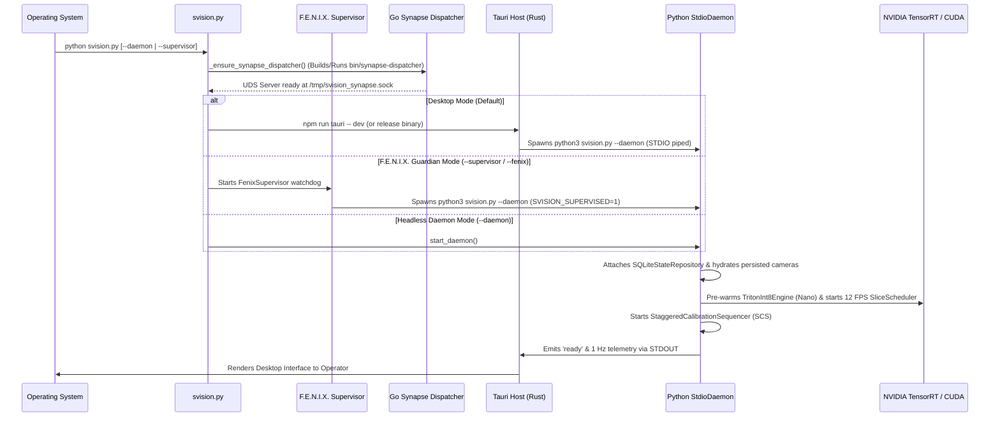

[🏠 Home](index.md) › **Architecture Overview**

---

# SVision — System Architecture Overview

> SVision — Architecture Documentation  
> Copyright © 2026 Gabriel Moraes — Noxfort Systems

---

## 1. Executive Summary

**SVision** is a sovereign artificial intelligence platform engineered to run on high-performance workstations (*Sovereign Workstation AI*) equipped with dedicated NVIDIA GPUs for real-time urban traffic analysis and autonomous signal orchestration.

The architecture strictly follows **SOLID**, **Local Workstation Sovereignty**, **Zero-Network IPC**, and **Out-of-Process Resilience (F.E.N.I.X.)** principles, ensuring that no raw video frames traverse external networks and that all computer vision processing occurs locally on dedicated hardware accelerators (NVIDIA TensorRT / CUDA).

```
┌─────────────────────────────────────────────────────────────────────────────┐
│                  svision.py  (Optional: --supervisor / --fenix)             │
│               Master Bootstrapper & F.E.N.I.X. Guardian Lifecycle           │
├───────────────────────┬──────────────────────────┬──────────────────────────┤
│   Rust Desktop Host   │      Python AI Core      │  Go Synapse Dispatcher   │
│   (Tauri v2 + WebKit) │   (PyTorch + TensorRT)   │      (svision-go)        │
│  ┌─────────────────┐  │   ┌──────────────────┐   │   ┌──────────────────┐   │
│  │ React 19 UI     │  │   │ StdioDaemon      │   │   │ UDSServer        │   │
│  │ Vite + Tailwind │  │   │ CommandRouter    │   │   │ (/tmp/svision_   │   │
│  │ ECharts Charts  │  │   │ SQLite Hydration │   │   │  synapse.sock)   │   │
│  └────────┬────────┘  │   └────────┬─────────┘   │   └────────┬─────────┘   │
│           │           │            │             │            │             │
│  ┌────────▼────────┐  │   ┌────────▼─────────┐   │   ┌────────▼─────────┐   │
│  │ Native Subproc  │◄═╪══►│ StdioTransport  │   │   │ PortManager      │   │
│  │ STDIN / STDOUT  │  │   │ (Zero-Port IPC)  │   │   │ TCP Multiplexer  │   │
│  └─────────────────┘  │   └────────┬─────────┘   │   └────────┬─────────┘   │
│                       │            │             │            │             │
│                       │   ┌────────▼─────────┐   │            │             │
│                       │   │ SliceScheduler   │   │            │             │
│                       │   │ TritonInt8Engine │   │            │             │
│                       │   │ 2D Kalman + LWR  │   │            │             │
│                       │   └────────┬─────────┘   │            │             │
│                       │            │ UDS Push    │            │             │
│                       │            └─────────────┼────────────┘             │
│                       │                          │  Outbound TCP Streams    │
│                       │                          ▼  (1 Hz Fluid Telemetry)  │
│                       │               ┌───────────────────────┐             │
│                       │               │ Central Synapse Core  │             │
│                       │               └───────────────────────┘             │
└───────────────────────┴─────────────────────────────────────────────────────┘
```

---

## 2. The Three Execution Layers (+ Guardian Supervisor)

The platform decouples responsibilities across three specialized cooperating processes, optionally guarded by the **F.E.N.I.X.** out-of-process supervisor:

### Layer 1: Desktop Shell (Rust + Tauri v2 + React 19)
- **Source Location**: [`src-tauri/`](desktop-ui-tauri.md) and [`ui/`](desktop-ui-tauri.md).
- **Function**: Provides a modern, responsive, low-resource desktop control interface for traffic monitoring operators (including live homography calibration, per-camera tuning parameters, and an offline browser Demo Mode).
- **Key Advantage**: Leverages the system's native WebKitGTK runtime via Tauri v2 instead of bundling Chromium, cutting memory footprint by ~80% compared to Electron.
- **Communication**: Manages the lifecycle of the Python backend as a child process over standard OS pipes (`STDIN`/`STDOUT`), without opening local network ports ([`ipc-architecture.md`](ipc-architecture.md)).

### Layer 2: Cognitive AI Core (Python 3.12 + PyTorch + TensorRT)
- **Source Location**: [`src/`](gpu-pipeline.md).
- **Function**: Decodes incoming RTSP camera feeds via dedicated NVDEC reader threads, extracts dynamic foveated regions of interest (*Neural Crop & Zoom*), schedules 12 FPS slices under `ElasticGovernor` VRAM bounds, runs chunked TensorRT inference via `TritonInt8Engine`, tracks vehicles using 2D Kalman ByteTrack, and emits 1 Hz Eulerian fluid dynamics telemetry (`FluidFlowEstimator`).
- **Operational Modes**: Runs synchronously with the desktop GUI, as an autonomous headless server daemon (`--daemon`), or under **F.E.N.I.X.** crash-resilient supervision (`--supervisor` / `--fenix`, documented in [`fenix-supervisor.md`](fenix-supervisor.md)).

### Layer 3: Network Gatekeeper (Go Synapse Dispatcher)
- **Source Location**: [`svision-go/`](synapse-dispatcher-go.md).
- **Function**: Isolates the network stack and multiplexes persistent outbound TCP telemetry streams to the central Synapse cluster with strict zero-backlog drop semantics.
- **Automatic Compilation**: The master bootstrapper [`svision.py`](configuration-reference.md) detects the Go toolchain and automatically compiles the native binary `bin/synapse-dispatcher` when absent.
- **Interchange**: Receives telemetry payloads from Python over a Unix Domain Socket (`/tmp/svision_synapse.sock`), safeguarding the AI engine against network stalls.

---

## 3. Architectural Principles

1. **Local Workstation Sovereignty**: Video frames are processed strictly on the local workstation GPU; zero video pixels are dispatched to cloud services.
2. **Zero-Port IPC**: In-process standard I/O pipes eliminate local network sockets, protecting against browser-based port scanning and local firewall collisions.
3. **Zero-Backlog Fire-and-Forget Egress**: `SynapseUDSClient` and Go `CameraStream.Push()` drop packets immediately if sockets are unavailable, ensuring upstream network drops never stall the GPU pipeline.
4. **SOLID Modularity & Per-Camera Isolation**: Single-responsibility components (SRP) with dependency injection (DIP) and isolated per-camera `KalmanPredictiveTracker` and `ModelGearbox` instances managed by `PipelineSupervisor`.
5. **Out-of-Process Self-Healing (F.E.N.I.X.)**: `FenixSupervisor` prevents infinite crash loops, purges leaked CUDA VRAM (`torch.cuda.empty_cache()`, `ipc_collect()`), and reconciles camera state before restarting the cognitive engine.
6. **LGPD Compliance by Design**: Automatic memory scrubbing and traceback sanitization ([`security-lgpd.md`](security-lgpd.md)) ensure sensitive visual data never leaks into logs.

---

## 4. Boot Sequence



---

## 5. System Module Directory Mapping

| Module | Directory | Description and Documentation |
|--------|-----------|-------------------------------|
| **Bootstrapper** | `svision.py` | Unified launcher handling `.venv`/toolchain resolution, Go daemon supervision, F.E.N.I.X., and signal hooks |
| **F.E.N.I.X. Guardian** | `src/fenix/` | Out-of-process watchdog supervisor, windowed crash recovery, and CUDA state reconciler ([Doc](fenix-supervisor.md)) |
| **IPC Architecture** | `src/ipc/` | Zero-port STDIO daemon, 8-command router/handlers, SQLite hydration, and 1 Hz broadcaster ([Doc](ipc-architecture.md)) |
| **GPU Pipeline** | `src/engine/` | 12 FPS `SliceScheduler`, `ElasticGovernor`, `TritonInt8Engine`, `ModelGearbox`, `FluidFlowEstimator`, and `CUDABatchConsumer` fallback ([Doc](gpu-pipeline.md)) |
| **Computer Vision** | `src/vision/` | Threaded NVDEC `StreamDecoder`, 2D Kalman ByteTrack, `AutoLaneMapper` homography, and `ASCAnalyzer` ([Doc](vision-subsystem.md)) |
| **Camera Lifecycle** | `src/engine/scs_orchestrator.py` & `src/vision/asc_analyzer.py` | Live-frame SCS convergence (MOG2 + CLAHE + Farneback) and Node-Level `PRODUCTION` promotion ([Doc](camera-lifecycle.md)) |
| **Data Egress** | `src/network/` | `SynapseBuilder` fluid continuum schema, 1 Hz `FireForgetBatcher`, and `SynapseUDSClient` ([Doc](data-egress.md)) |
| **Go Dispatcher** | `svision-go/` | High-throughput UDS server (`0o600`) and zero-backlog TCP multiplexer ([Doc](synapse-dispatcher-go.md)) |
| **Desktop UI** | `ui/` + `src-tauri/` | Tauri v2 native shell and React 19 dashboard with Demo Mode & Calibration Modal ([Doc](desktop-ui-tauri.md)) |
| **Security & LGPD** | `src/api/` & `src/main.py` | Tensor sanitization, hardware telemetry (`HardwareTelemetry`), and process isolation ([Doc](security-lgpd.md)) |
| **Configuration** | `src/common/` | `SVisionConfig`, thread-safe `StateManager`, and `SQLiteStateRepository` persistence ([Doc](configuration-reference.md)) |

---

## Related Documents

- [🏠 Main Index / MOC](index.md)
- [🛡️ F.E.N.I.X. Process Supervisor](fenix-supervisor.md)
- [🔌 Zero-Port IPC Architecture](ipc-architecture.md)
- [⚡ GPU Inference Pipeline](gpu-pipeline.md)
- [👁️ Computer Vision Subsystem](vision-subsystem.md)
- [🔄 Camera Lifecycle](camera-lifecycle.md)
- [🌐 Go Synapse Dispatcher](synapse-dispatcher-go.md)
- [🖥️ Desktop UI (Tauri v2)](desktop-ui-tauri.md)
- [🔒 Security & LGPD Compliance](security-lgpd.md)
- [⚙️ Configuration Reference](configuration-reference.md)

---

<div align="center">
  <br/>
  <b>Noxfort Systems</b> — <i>A State Of Art Company</i><br/>
  <i>Sovereign Workstation Vision Engineering • SVISION v1.2.0</i><br/>
  <small>© 2026 Noxfort Systems • SPDX-License-Identifier: AGPL-3.0-or-later</small>
</div>
