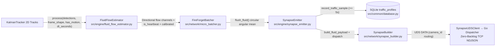

<!-- SPDX-License-Identifier: Proprietary -->
<!-- Copyright (c) 2026-present Gabriel Moraes / SVISION. All rights reserved. -->

# Data Egress & Macroscopic Fluid Flow Engine

SVISION Core streams **macroscopic directional traffic flow telemetry** — not discrete license plates, bounding boxes, or vehicle-counting events — with strict **Zero-Backlog Fire-and-Forget** delivery to downstream Synapse consumers.

> **Architectural update (v1.2.0):** Legacy event-counting and store-and-forward modules (`trigger_counter.py`, `trigger_detector.py`, `ram_buffer.py` / `ResilientRamBuffer`, and `channel_manager.py`) were completely removed. Egress now flows directly from `FluidFlowEstimator` → `FireForgetBatcher` → `SynapseEmitter` → `SynapseBuilder` → `SynapseUDSClient` → Go `CameraStream.Push()`.

---

## 1. End-to-End Egress Pipeline



---

## 2. Macroscopic Flow Estimation (`FluidFlowEstimator`)

Implemented in `src/engine/fluid_flow_estimator.py`, `FluidFlowEstimator.process(detections, frame_shape=(720, 1280), has_motion=True, dt_seconds=None)` translates 2D tracked detections into traffic fluid metrics:

1. **Dynamic Time Delta:** Uses actual inter-slice `dt_seconds` (`eff_fps = 1.0 / eff_dt`, falling back safely when unavailable) so speed estimation remains accurate even when `SliceScheduler` experiences jitter or thermal load.
2. **Spatial Road Density ($\rho$):**
   $$\rho = \text{clip}\!\left(\frac{\sum \text{bbox\_area}}{\text{effective\_road\_area}},\ 0.0,\ 1.0\right)$$
   where `effective_road_area` defaults to `0.70 * total_frame_area` (reflecting active drivable surface within the frame).
3. **Metric vs. Fallback Speed Calculation:**
   - **Calibrated (`calibrated = true`):** If a valid `3x3` homography matrix is loaded for the sensor (`state_manager` / SQLite / `AutoLaneMapper`), bottom-center displacement vectors are projected via `cv2.perspectiveTransform` into world coordinates and scaled by `eff_fps` to km/h.
   - **Uncalibrated (`calibrated = false`):** Uses an explicit pixel/bounding-box heuristic estimate and sets `"calibrated": false` in the emitted payload so downstream dashboards and Synapse nodes signal uncalibrated status clearly.
4. **Directional Channel Clustering (`max_angle_diff = 75.0°`):** Active velocity vectors whose heading falls within `75.0°` angular distance are clustered into directional channels (each carrying `direction_deg`, `speed`, and `density`), supporting multi-way intersections or opposing carriageways automatically.
5. **Heartbeat Continuity:** When a slice sees no active motion (`has_motion = False` or no detections), `FluidFlowEstimator` marks the sample `is_heartbeat = True` rather than suppressing output.

---

## 3. Circular Micro-Batching (`FireForgetBatcher`)

Located in `src/network/micro_batcher.py`, `FireForgetBatcher` aggregates per-slice samples between Synapse throttle ticks (`config.SYNAPSE_THROTTLE_INTERVAL`, default `0.2s` / 5 Hz max egress rate per sensor):

- **`record_fluid_sample()`:** Buffers channel readings for the active micro-window without disk queues or retry backlogs.
- **`flush_fluid()`:**
  - Averages `speed` and `density` across the window.
  - Computes **circular angular mean** for `direction_deg` via $\operatorname{atan2}(\sum \sin \theta, \sum \cos \theta)$ so headings near `0°` / `360°` average accurately without wrap-around discontinuities.
  - When idle (zero motion in the micro-window), emits a zeroed heartbeat vector `[{"direction_deg": 0.0, "speed": 0.0, "density": 0.0}]` with `is_heartbeat = True`.

---

## 4. Payload Construction & Dual-ID Routing (`SynapseBuilder` & `SynapseEmitter`)

### Canonical Fluid Payload (`SynapseBuilder.build_fluid_payload`)
`src/network/synapse_builder.py` formats every outgoing NDJSON packet as:

```json
{
  "camera_id": "CAM_NORTE_01",
  "timestamp": 1794841200123,
  "is_heartbeat": false,
  "calibrated": true,
  "channels": [
    {
      "direction_deg": 92.4,
      "speed": 48.6,
      "density": 0.24
    },
    {
      "direction_deg": 271.1,
      "speed": 51.2,
      "density": 0.19
    }
  ]
}
```

| Field | Type | Description |
| :--- | :--- | :--- |
| `camera_id` | `string` | External **Synapse `sensor_id`** (fallback to internal `cam_id` if unset) for downstream Synapse correlation. |
| `timestamp` | `int` | Unix epoch milliseconds (`int(time.time() * 1000)`). |
| `is_heartbeat` | `bool` | `true` when zero moving vehicles were tracked during the emission interval. |
| `calibrated` | `bool` | `true` when metric speed comes from an active `3x3` homography matrix; `false` for pixel estimation fallback. |
| `channels` | `array` | List of directional flow aggregates (`direction_deg` in `[0, 360)`, `speed` km/h, `density` in `[0.0, 1.0]`). |

### Dual-ID Routing & Traffic Profile Persistence
1. **Routing Key Separation (`SynapseBuilder.dispatch(payload, camera_id=None)`):** Although `payload["camera_id"]` carries the external `sensor_id`, `SynapseEmitter` explicitly passes the internal `self._cam_id` to `dispatch(..., camera_id=self._cam_id)`. `SynapseBuilder` routes the UDS `DATA` frame using `camera_id or payload.get("sensor_id") or payload.get("camera_id", "")`, ensuring `svision-go` always locates the right `CameraStream` port even when custom external `sensor_id` labels are used.
2. **SQLite Traffic Profile History:** `SynapseEmitter.emit()` periodically calls `state_manager.record_traffic_sample(self._cam_id, avg_density, avg_speed)` (minimum interval `5.0s`), appending historical traffic averages into SQLite table `traffic_profiles`.
3. **In-Memory UI Snapshot:** `SynapseEmitter` simultaneously updates `state_manager.update_traffic_snapshot(...)`, allowing `TelemetryBroadcaster` (`network_stats` event) and `SynapseTelemetryGrid.jsx` to render live directional channels and calibration badges in the desktop workstation UI.

---

## 5. Related Documentation

- [Synapse Dispatcher (Go)](synapse-dispatcher-go.md)
- [IPC Architecture](ipc-architecture.md)
- [Vision Subsystem](vision-subsystem.md)
- [API & IPC Reference](api-and-ipc-reference.md)

---

*SVISION Core Documentation — v1.2.0 (2026-11-16)*
