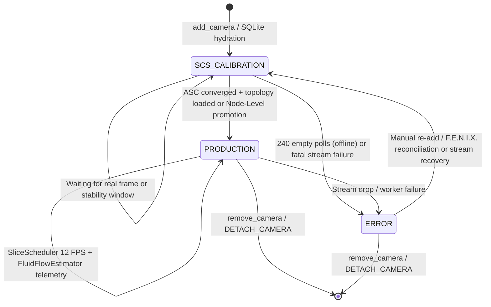

<!-- SPDX-License-Identifier: Proprietary -->
<!-- Copyright (c) 2026-present Gabriel Moraes / SVISION. All rights reserved. -->

# Camera Lifecycle & Autonomic Calibration

Every camera registered in SVISION Core transitions through a deterministic state machine managed by `CameraAgent` (`src/engine/camera_agent.py`), `SCSOrchestrator` (`src/engine/scs_orchestrator.py`), `AutonomicSceneConvergence` (`src/vision/asc_analyzer.py`), and `PipelineSupervisor` (`src/engine/pipeline_supervisor.py`), with durable persistence in SQLite (`src/common/database.py`) and fault reconciliation via F.E.N.I.X. (`src/fenix/state_reconciler.py`).

> **Scope note:** SVISION Core operates in a **Node-Level Traffic Flow** model (`PRODUCTION` state) emitting continuous directional traffic vectors via `FluidFlowEstimator`. Historical modules such as `pbt_optimizer.py` and offline `.pt` topology files were removed; topology calibration uses `AutoLaneMapper` JSON files (`~/Documentos/Svision/topologies/<camera_id>.json`) or live 4-point homography (`set_homography`).

---

## 1. Camera Lifecycle State Machine

### Primary States

| Status | Meaning | Transition Trigger |
| :--- | :--- | :--- |
| **`SCS_CALIBRATION`** | Initial state upon registration (`add_camera`) or SQLite hydration on daemon boot | `AutonomicSceneConvergence.start_calibration(camera_id)` |
| **`PRODUCTION`** | Active 12 FPS `SliceScheduler` slicing, YOLO INT8 inference, 2D Kalman tracking, and continuous `FluidFlowEstimator` emission | Convergence threshold met + `has_topology()` / Node-Level promotion |
| **`ERROR`** | Stream acquisition failure, 240 empty frame polls (~12s) without video data, or fatal subsystem fault | Offline camera timeout (`max_empty_polls = 240`) or unrecoverable decoder error |

---

## 2. Step-by-Step Calibration & Promotion Flow

### Step 1: Registration & Persistence
When `add_camera` arrives via IPC (`src/ipc/command_handlers.py`) or `StdioDaemon._hydrate_persisted_cameras()` (`src/ipc/stdio_daemon.py`) replays persisted sensors at startup:
1. `CameraStateManager` updates the in-memory `CameraInfo` record and persists the `CameraNode` row to SQLite (`svision_telemetry.db`) — including `id`, `name`, `address`, `sensor_id`, `synapse_port`, `homography_json`, and `params_json`.
2. `NvdecStreamDecoder.connect_camera(camera_id, url)` spawns a dedicated background reader thread that continually drains RTSP/video frames (`max_dim = 720`).
3. `SynapseUDSClient.attach_camera(camera_id, sensor_id, preferred_port)` sends `ATTACH_CAMERA` over UDS to `bin/synapse-dispatcher`.
4. `SCSOrchestrator.enqueue_camera(camera_id)` triggers asynchronous `AutonomicSceneConvergence.start_calibration(camera_id)`.

### Step 2: Real-Frame Acquisition (Zero Synthetic Fallback)
Inside `_run_scs_calibration(camera_id)` (`src/vision/asc_analyzer.py`):
- The calibration loop polls `stream_decoder.read_latest_frame(camera_id)` in `asyncio` steps (~`0.05s` intervals).
- Empty polls increment a counter up to `max_empty_polls = 240`.
- **No synthetic noise fallback:** If a camera is offline, unreachable, or removed before delivering frames, `AutonomicSceneConvergence` logs an error/termination and stops calibration cleanly without feeding random synthetic arrays into MOG2 or optical flow.

### Step 3: Scene Stability Evaluation (`ASCAnalyzer`)
Once real decoded frames arrive, `AutonomicSceneConvergence` evaluates scene stability frame-by-frame:
1. **Background Stabilization (MOG2):** Computes foreground mask energy ratio to derive `gmm_score`.
2. **Dense Flow Stability (`OpticalFlowAnalyzer`):** Computes optical flow motion stability `flow_stability`.
3. **Composite Stability Score:**
   $$\text{score} = \min\big(100.0,\ (\text{gmm\_score} \times 0.7) + (\text{flow\_stability} \times 100.0 \times 0.3)\big)$$
4. **Adaptive Stability Window:**
   - Reads `threshold = config.PIPELINE_SCS_THRESHOLD` (default `0` for immediate Node-Level startup; `98.0` for strict multi-frame scene convergence).
   - Required consecutive frames meeting `score >= threshold`: `required_stable = 30 if threshold >= 90.0 else 5`.

### Step 4: Topology Resolution & `PRODUCTION` Promotion
Upon meeting `required_stable` frames:
1. `SCSOrchestrator` checks `lane_mapper.has_topology(camera_id)` and attempts `lane_mapper.load_topology(camera_id)`.
2. `AutoLaneMapper` (`src/vision/lane_mapper.py`) looks for JSON topology artifacts in `~/Documentos/Svision/topologies/<camera_id>.json`. By default in **Node-Level Traffic Flow** mode, `has_topology()` returns `True` so sensors immediately proceed to `PRODUCTION`.
3. If an explicit topology discovery pass is needed, `_run_discovery()` promotes the node directly to `PRODUCTION` (DBSCAN `_compile_topology()` and `_sector_wedge_polygon()` geometric helpers remain available in `AutoLaneMapper` for offline sector/lane modeling).

---

## 3. Isolated Execution State in `PRODUCTION`

During `PRODUCTION`, each camera receives dedicated, cross-isolated state managed by `PipelineSupervisor` (`src/engine/pipeline_supervisor.py`):
- **Isolated `ModelGearbox` & `KalmanTracker`:** Prevents cross-camera gear bleed and track ID collisions across batches.
- **Per-Camera `FluidFlowEstimator`:** Aggregates active track velocities, bounding-box pixel density, and homography-calibrated speeds into directional channels (`direction_deg`, `speed`, `density`).
- **Live Parameter & Homography Injection:** `update_camera_params` and `set_homography` update per-camera `tuning_params` (confidence threshold, NMS threshold, nominal direction, approach) and `3x3` projective matrices atomically in SQLite and live vision pipelines without restarting the stream.
- **Heartbeat Continuity:** Even when zero vehicles are moving (`has_motion = False`), `FireForgetBatcher` + `SynapseEmitter` preserve continuous JSON cadence (`is_heartbeat: true`) so downstream consumers distinguish an empty road from a disconnected camera.

---

## 4. Cleanup, Teardown & Fault Reconciliation

- **Manual Removal (`remove_camera`):** Cancels pending SCS tasks, removes entries from `PipelineSupervisor`, `CameraStateManager`, and SQLite (`cameras` table), disconnects `NvdecStreamDecoder` reader threads, and sends `DETACH_CAMERA` to `bin/synapse-dispatcher`.
- **Daemon Shutdown (`StdioDaemon.shutdown`):** Stops `PipelineOrchestrator`, stops `SynapseUDSClient`, calls `stream_decoder.disconnect_all()`, flushes CUDA cache, and calls `cleanup_synapse_dispatcher()` to reap the Go child process cleanly.
- **Crash Recovery (F.E.N.I.X.):** When running under `python svision.py --supervisor`, `VisionStateReconciler` resets `PRODUCTION`/`CALIBRATING` flags if needed, purges stale GPU/VRAM allocations, and re-hydrates `CameraNode` rows from SQLite when the worker respawns. See [F.E.N.I.X. Supervisor](fenix_supervisor.md).

---

## 5. Related Documentation

- [F.E.N.I.X. Supervisor](fenix_supervisor.md)
- [GPU Pipeline & Gearboxes](gpu_pipeline.md)
- [Vision Subsystem](vision_subsystem.md)
- [Data Egress & Flow Engine](data_egress.md)
- [API & IPC Reference](api_and_ipc_reference.md)

---

*SVISION Core Documentation — v1.2.0 (2026-11-16)*
