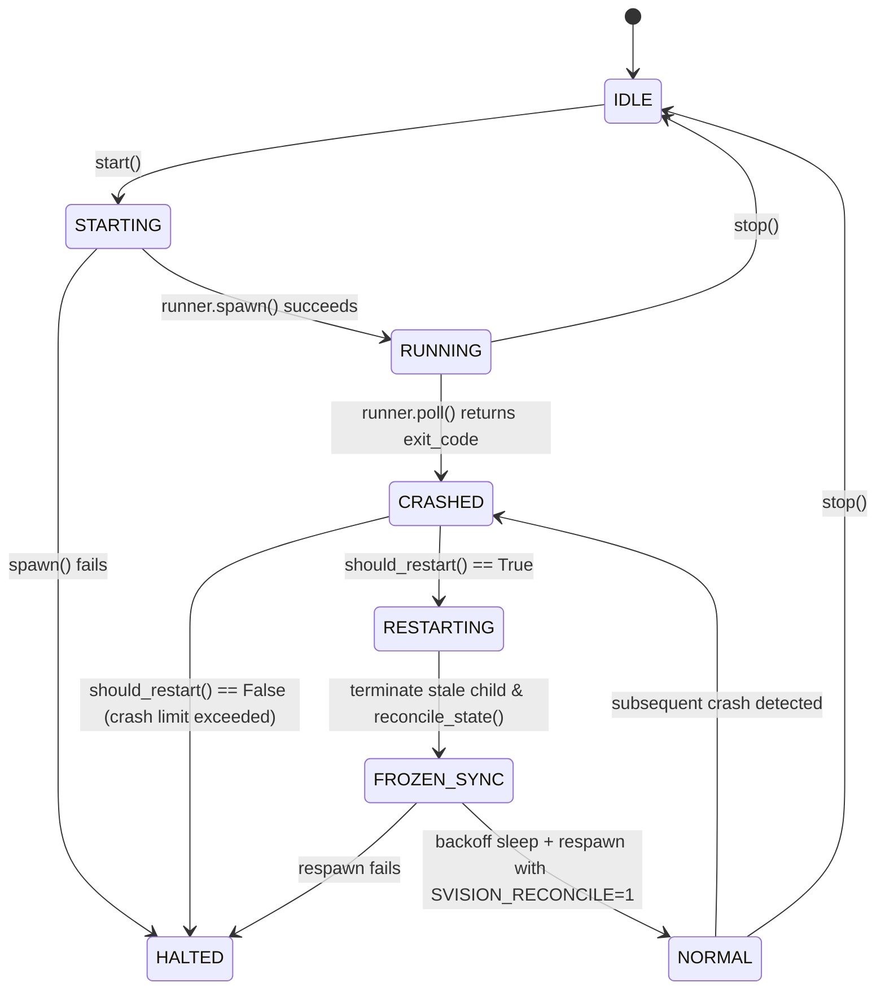

[🏠 Home](../index.md) › **F.E.N.I.X. Process Supervisor**

---

# F.E.N.I.X. Supervisor — Out-of-Process Self-Healing & State Reconciliation

> SVision — Architecture Documentation  
> Copyright © 2026 Gabriel Moraes — Noxfort Systems

---

## 1. Overview

**F.E.N.I.X.** (*Fail-safe Evolutionary Neural Inference eXchange*, located in [`src/fenix/`](../../src/fenix)) is SVISION's out-of-process guardian supervisor engineered to isolate fatal native/CUDA faults, prevent infinite crash loops, purge contaminated GPU memory, and resurrect the headless cognitive daemon cleanly.

Running `svision.py --supervisor` (or `--fenix`) launches `FenixSupervisor`, which supervises the child `svision.py --daemon` process via an independent watchdog thread.

---

## 2. SOLID Component Architecture (`src/fenix/`)

Every component depends exclusively on `@runtime_checkable` protocols defined in `src/fenix/protocols.py`:

| File | Protocol / Class | Responsibility (SRP) |
|---|---|---|
| `src/fenix/protocols.py` | `FenixState`, `IRecoveryPolicy`, `IProcessRunner`, `IStateReconciler`, `IProcessSupervisor` | Segregated contracts and lifecycle state enum (`IDLE`, `STARTING`, `RUNNING`, `CRASHED`, `RESTARTING`, `FROZEN_SYNC`, `NORMAL`, `HALTED`). |
| `src/fenix/fenix_supervisor.py` | `FenixSupervisor` | Top-level facade coordinating child spawning, watchdog polling (`poll_interval_seconds=1.0`), crash handling, reconciliation, and shutdown. |
| `src/fenix/process_runner.py` | `SubprocessRunner` | Wraps `subprocess.Popen` with thread-safe `spawn()`, `poll()`, and graceful `SIGTERM` → `SIGKILL` fallback termination. |
| `src/fenix/multiprocessing_runner.py` | `MultiprocessingProcessRunner` | Adapts `multiprocessing.Process` to `IProcessRunner` for worker-level supervision. |
| `src/fenix/recovery_policy.py` | `WindowedCrashRecoveryPolicy` | Sliding-window anti-loop circuit breaker and exponential backoff calculator. |
| `src/fenix/state_reconciler.py` | `VisionStateReconciler` | Scrubs CUDA VRAM (`torch.cuda.empty_cache()`, `torch.cuda.ipc_collect()`), reconciles active camera registrations from `StateManager`, and probes the Go UDS socket (`config.SYNAPSE_UDS_PATH`). |

---

## 3. Lifecycle State Machine & Resurrection Flow



### Step-by-Step Resurrection (`resurrect_engine()`)
1. **Circuit Breaker Check**: `WindowedCrashRecoveryPolicy.should_restart()` evaluates whether crashes within the sliding window (`crash_window_seconds=60.0`) remain within `max_consecutive_crashes=5`. If exceeded, transitions to `FenixState.HALTED` to protect workstation CPU/GPU resources.
2. **Zombie Termination**: Calls `runner.terminate(timeout_seconds=2.0)` (`SIGTERM`, escalating to `SIGKILL` on timeout).
3. **VRAM Purge & State Reconciliation (`FROZEN_SYNC`)**:
   - Invokes `gc.collect()`, `torch.cuda.empty_cache()`, and `torch.cuda.ipc_collect()`.
   - Synchronizes registered camera IDs from `StateManager.get_cameras()`.
   - Checks existence of the Go Synapse Dispatcher Unix socket at `config.SYNAPSE_UDS_PATH` (`/tmp/svision_synapse.sock`).
4. **Progressive Exponential Backoff**: Sleeps `restart_backoff_seconds * min(2 ** (crash_count - 1), 8)` seconds (defaults: `1.0s`, `2.0s`, `4.0s`, `8.0s`).
5. **Clean Respawn**: Spawns the child daemon with `SVISION_SUPERVISED=1`, `SVISION_RECONCILE=1`, and `PYTHONUNBUFFERED=1`, transitioning to `FenixState.NORMAL`.

---

## 4. CLI Usage & Environment Integration

### Launching Under F.E.N.I.X. Supervision
```bash
# Start SVISION headless daemon protected by F.E.N.I.X.
python svision.py --supervisor
# Alias:
python svision.py --fenix
```

### Injected Supervision Environment Variables
| Variable | Value on Start / Resurrection | Purpose |
|---|---|---|
| `SVISION_SUPERVISED` | `"1"` | Signals to the child daemon that an external F.E.N.I.X. supervisor owns its lifecycle. |
| `SVISION_RECONCILE` | `"1"` (on resurrection) | Indicates the process was respawned after a crash and reconciliation pass. |
| `PYTHONUNBUFFERED` | `"1"` | Guarantees immediate stderr/stdout flushing across process pipes. |

---

## 5. Diagnostic Summary API

`VisionStateReconciler.get_status_summary()` exposes structured diagnostics used by automated verification suites (`tests/test_fenix_*.py`):

```python
{
    "is_reconciled": True,
    "reconciled_cameras_count": 4,
    "reconciled_cameras": ["cam_01", "cam_02", "cam_03", "cam_04"],
    "vram_purged_count": 1,
    "uds_socket_exists": True,
}
```

---

## Related Documents

- [🏠 Main Index / MOC](../index.md)
- [🏗️ System Architecture Overview](architecture_overview.md)
- [⚡ GPU Inference Pipeline](gpu_pipeline.md)
- [🛠️ Workstation Deployment & Operations](deployment_operations.md)
- [🧪 Development & Testing Guide](development_testing.md)

---

<div align="center">
  <br/>
  <b>Noxfort Systems</b> — <i>A State Of Art Company</i><br/>
  <i>Sovereign Workstation Vision Engineering • SVISION v1.2.0</i><br/>
  <small>© 2026 Noxfort Systems • SPDX-License-Identifier: AGPL-3.0-or-later</small>
</div>
