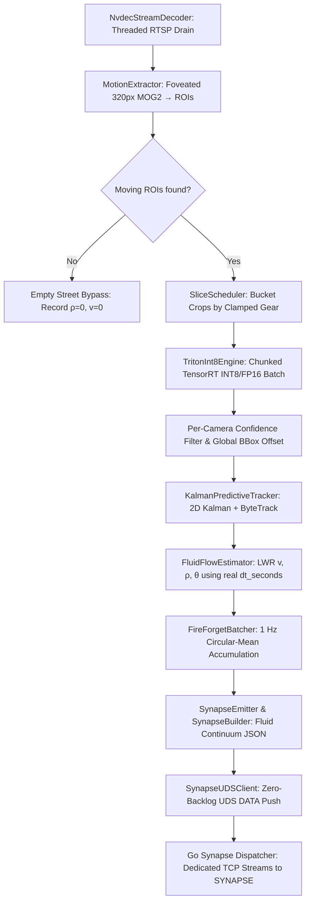

[🏠 Home](../index.md) › **GPU Inference Pipeline**

---

# GPU Inference Pipeline

> SVision — Architecture Documentation  
> Copyright © 2026 Gabriel Moraes — Noxfort Systems

---

## Overview

The SVision GPU inference pipeline implements an **Elastic Compute Fabric** paced at **12 FPS** (`~83.3ms` cycle), eliminating hardcoded batch sizes and thread contention on CUDA contexts.

In primary execution mode, [`CentralPipelineOrchestrator`](../../src/engine/pipeline_orchestrator.py) pre-warms [`TritonInt8Engine`](../../src/engine/triton_int8_engine.py) (`Nano` anchor) and starts [`SliceScheduler`](../../src/engine/slice_scheduler.py), which queries [`ElasticGovernor`](../../src/engine/elastic_governor.py) every cycle to partition active cameras into VRAM-safe dynamic slices. A legacy [`CUDABatchConsumer`](../../src/engine/cuda_batch_consumer.py) path remains supported as a fallback when no `TritonInt8Engine` is bound.

```
┌──────────────┐  ┌──────────────┐  ┌──────────────┐
│ CameraAgent  │  │ CameraAgent  │  │ CameraAgent  │
│   (cam_01)   │  │   (cam_02)   │  │   (cam_03)   │
│  Gear: Nano  │  │  Gear: Small │  │  Gear: Nano  │
└──────┬───────┘  └──────┬───────┘  └──────┬───────┘
       │ grab_and_extract_rois() (ThreadPoolExecutor + Foveated MotionExtractor)
       ▼                 ▼                 ▼
┌────────────────────────────────────────────────────────────────────┐
│               12 FPS SliceScheduler + ElasticGovernor              │
│                                                                    │
│  1. Evaluate Free VRAM & Latency → target_batch_size [4..32]       │
│  2. Clamp per-camera active_gear to recommended_gear_ceiling       │
│  3. Bucket moving crops by effective gear (Nano / Small / Medium)  │
└────────────────────────────────┬───────────────────────────────────┘
                                 │
                                 ▼
┌────────────────────────────────────────────────────────────────────┐
│                TritonInt8Engine (On-Demand VRAM Paging)            │
│                                                                    │
│  • Nano (.engine) permanently resident                             │
│  • Small / Medium / Heavy paged on demand, evicted after 30s idle  │
│  • Automatic batch chunking via _read_engine_batch_limit (def: 16) │
└────────────────────────────────┬───────────────────────────────────┘
                                 │ offset local ROI bboxes → full frame
                                 ▼
┌────────────────────────────────────────────────────────────────────┐
│      CameraAgent.post_inference_process(dets, gear_ceiling)        │
│                                                                    │
│  Isolated Kalman Tracker → FluidFlowEstimator (dt_seconds) →       │
│  Isolated ModelGearbox → 1 Hz SynapseEmitter                       │
└────────────────────────────────────────────────────────────────────┘
```

---

## Pipeline Components

### 1. CentralPipelineOrchestrator (`src/engine/pipeline_orchestrator.py`)

Top-level facade coordinating the platform engine lifecycle:

- Checks whether `SliceScheduler._engine` provides `initialize_base_model()` (standard `TritonInt8Engine` path) and warms up the `Nano` anchor on a background worker thread before starting `SliceScheduler`.
- Falls back to `inference_node.start_batch_consumer()` (`CUDABatchConsumer`) only if the scheduler engine lacks `initialize_base_model()`.
- Delegates camera agent discovery and cleanup to `PipelineSupervisor`.

### 2. PipelineSupervisor (`src/engine/pipeline_supervisor.py`)

Manages camera agent creation and teardown with **strict per-camera state isolation**:

- Polls `StateManager` every `PIPELINE_SUPERVISOR_POLL` seconds (default `2.0s`).
- Owns a persistent `ThreadPoolExecutor` (`PIPELINE_WORKER_THREADS=4`) for CPU-bound OpenCV tasks (`MotionExtractor`, frame grabbing).
- Instantiates a **dedicated `KalmanPredictiveTracker`** (`_create_isolated_tracker()`) and a **dedicated `ModelGearbox`** (`_create_isolated_gearbox()`) for every `CameraAgent`, preventing cross-camera track or gear contamination.

### 3. SliceScheduler & ElasticGovernor (`slice_scheduler.py` & `elastic_governor.py`)

Together they implement SVision's 12 FPS Elastic Compute Fabric:

- **VRAM & Latency Telemetry (`ElasticGovernor.evaluate`)**:
  - Samples real-time `vram_total` and `vram_usage` via `HardwareTelemetry` (`PyNVML`), reserving `GOVERNOR_VRAM_SAFETY_RATIO` (`15%`).
  - Triggers critical throttling (`is_vram_critical=True`, `target_batch_size=SCHEDULER_MIN_BATCH` = `4`, `recommended_gear_ceiling="Nano"`) when free VRAM drops below `GOVERNOR_VRAM_CRITICAL_MB` (`1000.0 MB`), or `"Small"` ceiling when free VRAM `< 1500.0 MB`.
  - Balances traffic `demand_factor` and exponential-smoothed inference latency (`record_inference_latency`) to compute `target_batch_size` clamped within `[4, 32]` (`SCHEDULER_MIN_BATCH` .. `SCHEDULER_MAX_BATCH`) and `num_slices = ceil(active_cameras / target_batch_size)`.
- **Staggered Execution & Per-Gear Bucketing (`SliceScheduler._process_slice`)**:
  1. Executes `agent.grab_and_extract_rois()` concurrently across cameras in the current slice.
  2. Skips static/empty scenes (`has_motion=False`) without touching the GPU.
  3. Clamps each camera's requested `ModelGearbox.current_gear` to `recommended_gear_ceiling` via `_clamp_gear_to_ceiling()`.
  4. Groups crops by `effective_gear`, calls `triton_int8_engine.infer_batch(batch_crops, gear=gear, conf_threshold=min_conf)` with the lowest per-camera `confidence_threshold` in that bucket, and filters individual returned detections against each camera's exact configured `confidence_threshold`.
  5. Offsets crop bounding boxes back to full-frame coordinates and invokes `agent.post_inference_process(dets, gear_ceiling=gear_ceiling)`.
  6. Sleeps any leftover cycle time (`PIPELINE_BASE_INTERVAL = 0.0833s`) so the GPU cools down ("elastic breathing").
  7. Every `10s`, calls `triton_int8_engine.evict_idle_models()`.

### 4. TritonInt8Engine (`src/engine/triton_int8_engine.py`)

High-performance TensorRT execution and on-demand VRAM paging manager:

- **Permanent Anchor**: `initialize_base_model()` keeps **Nano** (`yolo11n.engine` / `.pt`) permanently resident in VRAM.
- **On-Demand Paging & Eviction**: `Small` (`yolo11s`), `Medium` (`yolo11m`), and `Heavy` (`yolo11x`) are loaded only when requested by `ModelGearbox` and evicted by `evict_idle_models()` after `GEARBOX_HEAVY_DWELL_SECONDS` (`30.0s`) of inactivity (`torch.cuda.empty_cache()`).
- **Dynamic Engine Batch Chunking**: `_read_engine_batch_limit()` parses the 4-byte little-endian Ultralytics JSON metadata header embedded in compiled `.engine` files to determine the maximum dynamic TensorRT batch profile (defaulting to `config.TRT_MAX_BATCH = 16`), automatically slicing oversized crop lists into compliant chunks during `infer_batch()`.

### 5. Model Gearbox (`src/engine/model_gearbox.py`)

Pure finite-state machine deployed **per camera** using Exponential Moving Average (`GEARBOX_EMA_ALPHA = 0.15`), hysteresis bands, and dwell guards to prevent gear hunting:

| Gear | Model | Weight / Engine | Hysteresis Bands (EMA) | Dwell Time |
|------|-------|-----------------|------------------------|------------|
| **Nano (Anchor)** | YOLO 11n | `yolo11n.pt` / `.engine` | Up at `>= 12` | `3.0s` |
| **Small** | YOLO 11s | `yolo11s.pt` / `.engine` | Down `<= 7`, Up `>= 28` | `5.0s` |
| **Medium** | YOLO 11m | `yolo11m.pt` / `.engine` | Down `<= 18`, Up `>= 60` | `5.0s` |
| **Heavy** | YOLO 11x | `yolo11x.pt` / `.engine` | Down `<= 40` | `8.0s` |

```
                 Per-Camera EMA Traffic Load Signal
                                │
         ┌──────────────────────┼──────────────────────┐
         ▼                      ▼                      ▼
       ┌────┐                ┌─────┐                ┌──────┐                ┌─────┐
       │Nano│ ──── >= 12 ──► │Small│ ──── >= 28 ──► │Medium│ ──── >= 60 ──► │Heavy│
       │    │ ◄─── <= 7 ──── │     │ ◄─── <= 18 ─── │      │ ◄─── <= 40 ─── │     │
       └────┘                └─────┘                └──────┘                └─────┘
       dwell:3s              dwell:5s               dwell:5s                dwell:8s
                    (Always clamped by ElasticGovernor gear_ceiling)
```

### 6. Supporting GPU & Staging Modules
- **RamStagingPool (`src/engine/ram_staging_pool.py`)**: Stages crops in system host RAM, performs letterboxing (`640×640`), pins host memory (`pin_memory()`), and executes asynchronous PCIe DMA transfers (`non_blocking=True`) on a dedicated CUDA stream.
- **VipKernelScheduler (`src/engine/vip_scheduler.py`)**: Allocates high-priority (`priority=-1`) asynchronous `torch.cuda.Stream` instances per camera/consumer.
- **CUDABatchConsumer (`src/engine/cuda_batch_consumer.py`) & InferenceNode (`src/engine/inference_node.py`)**: Fallback producer-consumer `asyncio.Queue` batching (`max_batch=8`, `timeout=5ms`) with `torch.cuda.amp.autocast`, used in standalone `CameraAgent.run()` or when `SliceScheduler` runs without `TritonInt8Engine`.

---

## Foveated Neural Crop & Zoom (`src/engine/motion_extractor.py`)

Instead of submitting full 720p/1080p/4K frames to neural inference every tick, `MotionExtractor` focuses GPU compute strictly on persistent moving regions:

1. **Peripheral Downscaling**: Resizes the incoming frame to `INFERENCE_PERIPHERAL_WIDTH = 320px` (preserving aspect ratio) for sub-millisecond CPU `BackgroundSubtractorMOG2` foreground extraction.
2. **Morphological Cleanup**: Applies elliptical close + open kernels and binary thresholding (`200`).
3. **Temporal Consistency Grid Filter**: Tracks blob centroids in a `32px` grid (`INFERENCE_TEMPORAL_GRID_SIZE`) and promotes ROIs only after `INFERENCE_TEMPORAL_MIN_FRAMES = 3` consecutive active frames.
4. **Fovea Back-Projection & Merging**: Scales confirmed ROIs back to original frame dimensions, adds `INFERENCE_CROP_PADDING = 32px`, and merges overlapping rectangles.

**Key Gains**:
- **60% to 80%** reduction in GPU pixel processing area.
- Higher effective pixel density on distant vehicles without running full-frame high-res models.
- Lower workstation GPU power draw and thermal throttling.

---

## Full Processing Flow



---

## Related Documents

- [🏠 Main Index / MOC](../index.md)
- [🏗️ Architecture Overview](architecture_overview.md)
- [🛡️ F.E.N.I.X. Process Supervisor](fenix_supervisor.md)
- [👁️ Computer Vision Subsystem](vision_subsystem.md)
- [🔄 Camera Lifecycle (SCS & Topology)](camera_lifecycle.md)
- [📤 Data Egress & Telemetry](data_egress.md)
- [🌐 Go Synapse Dispatcher](synapse_dispatcher_go.md)

---

<div align="center">
  <br/>
  <b>Noxfort Systems</b> — <i>A State Of Art Company</i><br/>
  <i>Sovereign Workstation Vision Engineering • SVISION v1.2.0</i><br/>
  <small>© 2026 Noxfort Systems • SPDX-License-Identifier: AGPL-3.0-or-later</small>
</div>
