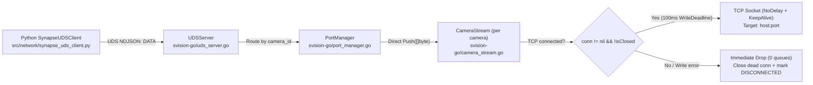

<!-- SPDX-License-Identifier: Proprietary -->
<!-- Copyright (c) 2026-present Gabriel Moraes / SVISION. All rights reserved. -->

# Synapse Dispatcher (Go)

`svision-go/` (`package main`, compiled to `bin/synapse-dispatcher`) is SVISION Core's lightweight, zero-backlog network egress sidecar written in Go. It isolates raw TCP socket lifecycle, port allocation, and non-blocking NDJSON telemetry delivery from Python's GPU inference loop so slow or unreachable downstream Synapse nodes never cause Python GIL pauses or memory buildup.

---

## 1. Flat Package Structure & Responsibilities

All Go source files reside in a single flat `main` package under `svision-go/`:

| File | Responsibility |
| :--- | :--- |
| [`svision-go/main.go`](../../svision-go/main.go) | CLI flag parsing (`--uds`, `--host`, `--base-port`), initializes `PortManager` and `UDSServer`, handles `SIGINT`/`SIGTERM` shutdown. |
| [`svision-go/uds_server.go`](../../svision-go/uds_server.go) | Unix Domain Socket listener (`/tmp/svision_synapse.sock`), restrictive `0600` permission hardening, 1 MB NDJSON line scanner, and command router. |
| [`svision-go/port_manager.go`](../../svision-go/port_manager.go) | Coordinates camera-to-port bindings (`AttachCamera`, `DetachCamera`, `PushData`, `UpdateHost`), tracks connected client count and status events. |
| [`svision-go/port_allocator.go`](../../svision-go/port_allocator.go) | Thread-safe TCP port pool starting from `--base-port` (default `9001`), preserving explicit `preferred_port` assignments when available. |
| [`svision-go/camera_stream.go`](../../svision-go/camera_stream.go) | Per-camera TCP connection worker (`runWorker`), `StreamDialer`/`DefaultTCPDialer` interface, synchronous zero-backlog `Push([]byte)`, and keepalive management. |
| `svision-go/*_test.go` | Five unit/integration test files covering dialer mocks, port allocation, port manager, camera streams, and UDS server protocol. |

---

## 2. Zero-Backlog Network Architecture (No Queues)

A defining invariant of `svision-go` is **Zero-Backlog Fire-and-Forget Delivery**:



- **No Buffered Channels:** Unlike buffered queue architectures, `CameraStream` does **not** allocate a bounded `chan []byte` queue. `Push(payload)` acquires the stream mutex and writes directly to the active `net.Conn` (appending `\n` if missing) with a strict **`100ms` write deadline**.
- **Immediate Drop on Offline Target:** If `isClosed` or `conn == nil`, `Push(payload)` immediately returns `false` and drops the packet so stale traffic snapshots never accumulate or surge after reconnection.
- **Background Reconnect Loop (`runWorker`):** Every **`2 seconds`**, each attached `CameraStream` checks if `conn == nil`. If disconnected, it emits `STATUS_CHANGE: "CONNECTING"` and attempts a TCP dial with a **`1500ms` timeout**.
- **Low-Latency Socket Tuning (`DefaultTCPDialer`):**
  - `TCP_NODELAY = true` (`SetNoDelay(true)`) — disables Nagle's algorithm so every telemetry packet flushes immediately.
  - `KeepAlive = true`, `KeepAlivePeriod = 10s` — detects half-open links cleanly.

---

## 3. UDS Control & Data Protocol

By default, `uds_server.go` creates `/tmp/svision_synapse.sock`, removes any stale socket file, binds a Unix stream socket, and enforces `chmod 0600` (customizable via `SVISION_SYNAPSE_UDS_MODE` environment variable). Scanner buffer max token size is `1 MB`.

### Inbound Commands (Python → Go)

| Command | Required / Optional Fields | Go Behavior & Response Event |
| :--- | :--- | :--- |
| **`ATTACH_CAMERA`** | `camera_id`, `sensor_id`, `preferred_port` | Allocates port via `PortAllocator`, starts `CameraStream.runWorker`, responds with **`CAMERA_BOUND`** (`status: "READY"`, `port`). |
| **`DETACH_CAMERA`** | `camera_id` | Closes `CameraStream`, releases TCP port back to pool, responds with **`CAMERA_DETACHED`** (`status: "CLOSED"`). |
| **`DATA`** | `camera_id`, `payload` | Looks up `CameraStream` by `camera_id` and executes `Push(payload)`. Silent fast-path on success (no per-packet UDS ack). |
| **`UPDATE_CONFIG`** | `synapse_host` | Updates target host across `PortManager` and forces existing streams to redial against the new host; emits **`CONFIG_UPDATED`** (`status: "OK"`). |
| **`PING`** | — | Responds immediately with **`PONG`** (`status: "OK"`). |

### Outbound Status Events (Go → Python)

```json
{"event": "CAMERA_BOUND", "camera_id": "cam-01", "sensor_id": "CAM_NORTE_01", "port": 9001, "status": "READY"}
{"event": "STATUS_CHANGE", "camera_id": "cam-01", "sensor_id": "CAM_NORTE_01", "port": 9001, "status": "CONNECTED"}
{"event": "STATUS_CHANGE", "camera_id": "cam-01", "sensor_id": "CAM_NORTE_01", "port": 9001, "status": "DISCONNECTED"}
{"event": "CAMERA_DETACHED", "camera_id": "cam-01", "status": "CLOSED"}
{"event": "CONFIG_UPDATED", "status": "OK"}
{"event": "PONG", "status": "OK"}
```

`SynapseUDSClient` forwards `CAMERA_BOUND`, `CAMERA_DETACHED`, and `STATUS_CHANGE` updates into `TelemetryBroadcaster`, updating the UI `synapse_ports` map in real time.

---

## 4. Building & Running Standalone

```bash
cd svision-go
go build -o ../bin/synapse-dispatcher .

# Standalone inspection (normally managed automatically by Python/F.E.N.I.X.)
../bin/synapse-dispatcher --uds /tmp/svision_synapse.sock --host 127.0.0.1 --base-port 9001
```

Running the Go test suite (including race detector where supported):

```bash
cd svision-go
go test -v -cover ./...
go test -race ./...
```

---

## 5. Related Documentation

- [IPC Architecture](ipc_architecture.md)
- [Data Egress & Flow Engine](data_egress.md)
- [API & IPC Reference](api_and_ipc_reference.md)
- [Security & LGPD](security_lgpd.md)

---

*SVISION Core Documentation — v1.2.0 (2026-11-16)*
