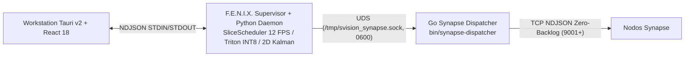

<!-- SPDX-License-Identifier: Proprietary -->
<!-- Copyright (c) 2026-present Gabriel Moraes / SVISION. All rights reserved. -->

# Resumen de Arquitectura — SVISION Core v1.2.0

SVISION Core opera bajo una arquitectura tripartida con aislamiento de fallos mediante **F.E.N.I.X. Supervisor**, cadencia determinística a **12 FPS (`SliceScheduler`)** y entrega **Zero-Backlog Fire-and-Forget** hacia nodos Synapse.

## Pilares Principales

1. **Supervisión y Resiliencia (`src/fenix/`):** Con `--supervisor` o `--fenix`, `FenixSupervisor` monitoriza el proceso worker, purga asignaciones CUDA mediante `VisionStateReconciler` y restaura el servicio tras fallos críticos.
2. **Pipeline GPU a 12 FPS (`src/engine/`):** `SliceScheduler` sincroniza lecturas foveadas (`MotionExtractor`), lotes dinámicos (`VipKernelScheduler`), control térmico/VRAM (`ElasticGovernor`) e inferencia TensorRT INT8 (`TritonInt8Engine`) con `ModelGearbox` y `KalmanTracker` aislados por cámara.
3. **Egress Macroscópico Sin Colas:** `FluidFlowEstimator` y `FireForgetBatcher` publican canales direccionales (`direction_deg`, `speed`, `density`, `calibrated`, `is_heartbeat`) hacia `svision-go`, que descarta paquetes si el socket TCP destino está caído para evitar acumulación de datos obsoletos.
4. **Persistencia SQLite y Privacidad LGPD:** `svision_telemetry.db` almacena únicamente configuraciones, matrices `3x3` y perfiles agregados — nunca fotogramas ni placas.

Para la especificación completa en inglés, consulte [Architecture Overview (EN)](../en/architecture_overview.md) y [F.E.N.I.X. Supervisor (EN)](../en/fenix_supervisor.md).

---

*Documentación SVISION Core — v1.2.0 (2026-11-16)*
