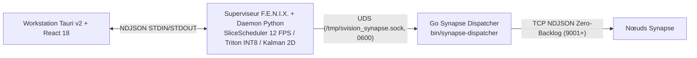

<!-- SPDX-License-Identifier: Proprietary -->
<!-- Copyright (c) 2026-present Gabriel Moraes / SVISION. All rights reserved. -->

# Vue d'Ensemble de l'Architecture — SVISION Core v1.2.0

SVISION Core repose sur une architecture tripartite dotée d'une supervision **F.E.N.I.X.**, d'un ordonnanceur temporel à **12 FPS (`SliceScheduler`)** et d'une diffusion **Zero-Backlog Fire-and-Forget** vers les nœuds Synapse.

## Principes Clés

1. **Résilience F.E.N.I.X. (`src/fenix/`):** En mode `--supervisor` / `--fenix`, `FenixSupervisor` surveille le worker, libère la VRAM via `VisionStateReconciler` et relance le service après une défaillance critique.
2. **Pipeline GPU 12 FPS (`src/engine/`):** `SliceScheduler` cadence l'extraction fovéale (`MotionExtractor`), l'ordonnancement dynamique (`VipKernelScheduler`), le contrôle thermique (`ElasticGovernor`) et l'inférence TensorRT INT8 (`TritonInt8Engine`) avec `ModelGearbox` et `KalmanTracker` isolés par caméra.
3. **Diffusion Sans File d'Attente:** `FluidFlowEstimator` et `FireForgetBatcher` génèrent des vecteurs directionnels (`direction_deg`, `speed`, `density`, `calibrated`, `is_heartbeat`) transmis via `svision-go`, qui abandonne immédiatement tout paquet si le socket TCP distant est fermé.
4. **Stockage SQLite et Confidentialité:** `svision_telemetry.db` conserve uniquement les paramètres des caméras, matrices `3x3` et profils agrégés — aucune image ni plaque n'est enregistrée.

Pour les spécifications détaillées en anglais, consultez [Architecture Overview (EN)](../en/architecture_overview.md) et [F.E.N.I.X. Supervisor (EN)](../en/fenix_supervisor.md).

---

*Documentation SVISION Core — v1.2.0 (2026-11-16)*
