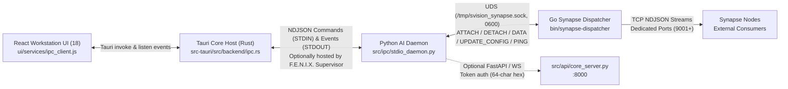

<!-- SPDX-License-Identifier: Proprietary -->
<!-- Copyright (c) 2026-present Gabriel Moraes / SVISION. All rights reserved. -->

# IPC Architecture & Inter-Process Communication

SVISION Core uses **Standard I/O (STDIN/STDOUT)** NDJSON messaging between the Tauri (Rust) host and the Python daemon — optionally supervised by **F.E.N.I.X.** (`src/fenix/`) — alongside a **Unix Domain Socket (UDS)** link between Python and the Go Synapse Dispatcher (`bin/synapse-dispatcher`). In addition, `src/api/` provides an optional HTTP/WebSocket telemetry & command server on port `8000`.

---

## 1. Tripartite IPC Topology

---

## 2. STDIN / STDOUT NDJSON Bridge (Rust ↔ Python)

Managed on the Rust side by `src-tauri/src/backend/ipc.rs` (`spawn_sidecar`) and on the Python side by `StdioDaemon` (`src/ipc/stdio_daemon.py`).

### Key Design Properties
- **Zero-Allocation Framing:** Each message is one UTF-8 JSON object terminated by `\n`.
- **Thread-Safe Writing (`StdoutTransport`):** Multiple Python coroutines/threads emit telemetry through `src/ipc/stdio_transport.py`, synchronized by a lock so JSON frames never interleave.
- **SQLite Hydration on Boot (`StdioDaemon.main`):** Upon daemon startup, `state_manager.attach_persistence(sqlite_repository, load_existing=True)` loads saved `CameraNode` rows from `~/Documentos/Svision/database/svision_telemetry.db`. If persisted cameras exist, `_hydrate_persisted_cameras()` automatically spawns RTSP reader threads, attaches ports to `synapse-dispatcher`, and triggers `SCSOrchestrator` calibration before the UI even clicks "Sync".
- **Graceful Shutdown (`StdioDaemon.shutdown`):** Handles `SIGINT`/`SIGTERM`, terminates the 12 FPS `PipelineOrchestrator`, closes `SynapseUDSClient`, calls `stream_decoder.disconnect_all()`, empties PyTorch CUDA cache, and invokes `cleanup_synapse_dispatcher()` to reap the Go child cleanly.

---

## 3. Command Routing (`src/ipc/command_router.py` & `command_handlers.py`)

`StdioDaemon` dispatches inbound STDIN JSON commands (`{"cmd": "...", ...}`) through `CommandRouter` to `CommandHandlers`:

| Command (`cmd`) | Purpose |
| :--- | :--- |
| `ping` | Liveness check (`pong` event/response). |
| `sync_state` | Snapshot sync returning `cameras`, `engine_stats`, `network_stats`, `synapse_ports`, `synapse_host`, `homography_matrices`, and `camera_params`. |
| `add_camera` | Registers a sensor (`id`, `name`, `address`, `sensor_id`, `synapse_port`), persists to SQLite, attaches UDS port, starts `NvdecStreamDecoder` reader, and queues `SCSOrchestrator`. |
| `remove_camera` | Removes sensor from memory & SQLite, stops reader thread, cancels calibration, and sends `DETACH_CAMERA` over UDS. |
| `set_cameras` | Bulk declarative camera synchronization list. |
| `update_synapse_config` | Updates target host (`synapse_host`), persists `settings.ini`, and sends `UPDATE_CONFIG` to Go. |
| `set_homography` | Saves and activates a `3x3` homography matrix (directly via `matrix` or computed via `AutoLaneMapper.compute_homography_from_points` from `>= 4` `image_points`/`world_points` pairs). |
| `update_camera_params` | Updates live `tuning_params` (`confidence_threshold`, `nms_threshold`, `exposure_compensation`, `gamma`, `nominal_direction`, `approach`) with safety clamping (`[0.05, 0.99]`) and SQLite persistence. |

Full schemas and example payloads are documented in [API & IPC Reference](api-and-ipc-reference.md).

---

## 4. Asynchronous Telemetry Broadcaster (`src/ipc/telemetry_broadcaster.py`)

`TelemetryBroadcaster.run_loop()` pushes periodic events to STDOUT (consumed by Rust `ipc.rs` and emitted to React via Tauri `app.emit(...)`) at `config.TELEMETRY_INTERVAL_SECONDS` (`1.0s` default):

| STDOUT Event `type` | Emitted By | Payload Summary |
| :--- | :--- | :--- |
| **`ready`** | `StdioDaemon` | Daemon booted, SQLite hydrated, UDS/pipeline ready |
| **`cameras`** | `TelemetryBroadcaster` | Full camera list (`status`, `fps`, `gear`, `synapse_port`, `homography_matrix`, `tuning_params`, latest traffic snapshot) |
| **`engine_stats`** | `TelemetryBroadcaster` | GPU/CPU/VRAM/RAM utilization, temperature, active gear, inference time, slice fill (`SliceScheduler`), active camera count |
| **`network_stats`** | `TelemetryBroadcaster` | Live egress payload snapshot per sensor, byte counters, throughput |
| **`synapse_ports`** | `TelemetryBroadcaster` | Go port status map (`camera_id -> {port, sensor_id, status, host}`) |
| **`network_latency`** | `TelemetryBroadcaster` | Per-sensor egress / processing latency metrics |
| **`gpu_health_alert`** | `TelemetryBroadcaster` | Emitted when GPU temperature or VRAM critical limits breach `ElasticGovernor` thresholds |

---

## 5. Unix Domain Socket (Python ↔ Go Dispatcher)

Managed on the Python side by `SynapseUDSClient` (`src/network/synapse_uds_client.py`) and on the Go side by `uds_server.go` (`svision-go/`):

- **Socket Path:** `/tmp/svision_synapse.sock` (permissions forced to `0600` on bind, overridable via `SVISION_SYNAPSE_UDS_MODE`).
- **Frame Cap:** `1 MB` max line length.
- **Outbound Commands (Python → Go):**
  - `ATTACH_CAMERA` (`camera_id`, `sensor_id`, `preferred_port`)
  - `DETACH_CAMERA` (`camera_id`)
  - `DATA` (`camera_id`, `payload`) — *strictly non-blocking fire-and-forget payload dispatch*
  - `UPDATE_CONFIG` (`synapse_host`)
  - `PING`
- **Inbound Events (Go → Python):**
  - `CAMERA_BOUND` (`status: "READY"`, `port`)
  - `CAMERA_DETACHED` (`status: "CLOSED"`)
  - `STATUS_CHANGE` (`CONNECTING`, `CONNECTED`, `DISCONNECTED`, `CLOSED`)
  - `CONFIG_UPDATED` (`status: "OK"`)
  - `PONG` (`status: "OK"`)
  - `ERROR`

---

## 6. Tauri Host Bridge & F.E.N.I.X. Integration

- **Tauri Backend (`src-tauri/src/backend/`):** Maintains a thread-safe handle (`mod.rs`, `state.rs`, `ipc.rs`) to the child Python process (`stdin`/`stdout`), exposes `send_svision_command` and `get_backend_status` commands, and ensures child reaping on desktop window exit.
- **Optional F.E.N.I.X. Supervision (`--supervisor` / `--fenix`):** When Python is launched through `svision.py --supervisor`, `FenixSupervisor` transparently owns the STDIN/STDOUT pipes with Tauri or wraps the headless worker daemon (`--daemon --supervised`), executing `VisionStateReconciler` if the worker crashes and restarting it with exponential backoff. See [F.E.N.I.X. Supervisor](fenix-supervisor.md).
- **UI Demo Fallback (`ui/services/ipc_client.js`):** When running React outside Tauri (`npm run dev` or `?demo=true`), `ipc_client.js` automatically runs a deterministic client-side simulation supporting `setHomography`, `updateCameraParams`, live `synapse_ports`, and simulated `cameras`/`engine_stats`/`network_stats` streams.

---

## 7. Related Documentation

- [F.E.N.I.X. Supervisor](fenix-supervisor.md)
- [Synapse Dispatcher (Go)](synapse-dispatcher-go.md)
- [API & IPC Reference](api-and-ipc-reference.md)
- [Desktop UI & Tauri](desktop-ui-tauri.md)

---

*SVISION Core Documentation — v1.2.0 (2026-11-16)*
