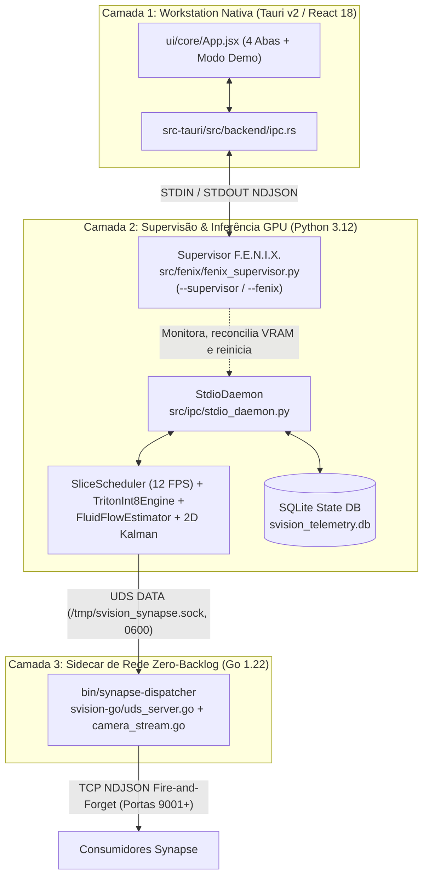

<!-- SPDX-License-Identifier: Proprietary -->
<!-- Copyright (c) 2026-present Gabriel Moraes / SVISION. All rights reserved. -->

# Visão Geral da Arquitetura

O **SVISION Core v1.2.0** é um motor distribuído de inteligência viária em tempo real projetado para operar sob alta densidade de câmeras com **zero bloqueio de rede**, **zero retenção de imagens (LGPD)** e **recuperação autonômica de falhas**.

---

## 1. Modelo Tripartido + Supervisão F.E.N.I.X.

---

## 2. Invariantes Arquiteturais

1. **Cadência Macro Canônica a 12 FPS (`SliceScheduler`):** Toda a malha de captura periférica (`MotionExtractor`), inferência em GPU (`TritonInt8Engine`) e rastreamento (`KalmanTracker`) é governada por janelas temporais determinísticas de ~`83.3 ms` (`SVISION_PIPELINE_TARGET_FPS = 12.0`).
2. **Isolamento Total por Câmera (`PipelineSupervisor`):** Cada sensor possui sua própria instância isolada de `ModelGearbox` e `KalmanTracker`, impedindo que picos de carga ou resets em um fluxo afetem outros cruzamentos.
3. **Egress Estreito Zero-Backlog:** Não existem filas de disco (`ram_buffer.py` removido) nem canais com buffer em Go. Caso o consumidor Synapse esteja offline, `CameraStream.Push()` descarta o pacote após `100ms` para garantir que apenas o estado atual do tráfego chegue à rede.
4. **Visão Computacional em Nível de Nó (*Node-Level Traffic Flow*):** Em vez de eventos individuais ou OCR de placas, `FluidFlowEstimator` publica vetores macroscópicos contínuos (`direction_deg`, `speed` em km/h e `density`), mantendo batimento contínuo (`is_heartbeat: true`) quando a via está vazia.
5. **Recuperação Autonômica F.E.N.I.X.:** Quando executado com `--supervisor` / `--fenix`, falhas críticas de driver CUDA ou daemon são interceptadas pelo `FenixSupervisor`, que purga memória VRAM via `VisionStateReconciler` e re-hidrata as câmeras salvas no SQLite automaticamente.

---

## 3. Sequência de Boot & Hidratação Persistente

1. **Inicialização do Daemon (`StdioDaemon.main`):** Conecta `CameraStateManager` ao `SQLiteStateRepository` (`~/Documentos/Svision/database/svision_telemetry.db`) via `attach_persistence(..., load_existing=True)`.
2. **Spawn do Sidecar Go:** Python verifica ou inicia `bin/synapse-dispatcher` escutando em `/tmp/svision_synapse.sock` (`chmod 0600`).
3. **Hidratação Automática (`_hydrate_persisted_cameras`):** Para cada `CameraNode` salvo no SQLite (incluindo `homography_json` e `params_json`), o sistema abre a thread de leitura `NvdecStreamDecoder`, envia `ATTACH_CAMERA` via UDS e enfileira o sensor no `SCSOrchestrator`.
4. **Sinalização `ready`:** `StdioDaemon` emite `{"type": "ready"}` em STDOUT e inicia o `TelemetryBroadcaster` (`1.0s`).

---

## 4. Mapa Resumido de Módulos

| Camada | Módulos-Chave | Documentação Detalhada |
| :--- | :--- | :--- |
| **Supervisão** | `fenix_supervisor.py`, `state_reconciler.py`, `recovery_policy.py` | [Supervisor F.E.N.I.X.](fenix_supervisor.md) |
| **Motor GPU** | `slice_scheduler.py`, `triton_int8_engine.py`, `elastic_governor.py`, `model_gearbox.py` | [Pipeline de GPU e Marchas](gpu_pipeline.md) |
| **Visão** | `stream_decoder.py`, `kalman_tracker.py`, `lane_mapper.py`, `asc_analyzer.py` | [Subsistema de Visão](vision_subsystem.md) |
| **Egress** | `fluid_flow_estimator.py`, `micro_batcher.py`, `synapse_emitter.py`, `synapse_builder.py` | [Egress de Dados](data_egress.md) |
| **IPC & Rede** | `stdio_daemon.py`, `command_handlers.py`, `svision-go/*.go` | [Arquitetura IPC](ipc_architecture.md) · [Go Dispatcher](synapse_dispatcher_go.md) |
| **Desktop** | `src-tauri/`, `ui/core/App.jsx`, `ui/services/ipc_client.js` | [UI Desktop e Tauri](desktop_ui_tauri.md) |

---

*Documentação SVISION Core — v1.2.0 (2026-11-16)*
