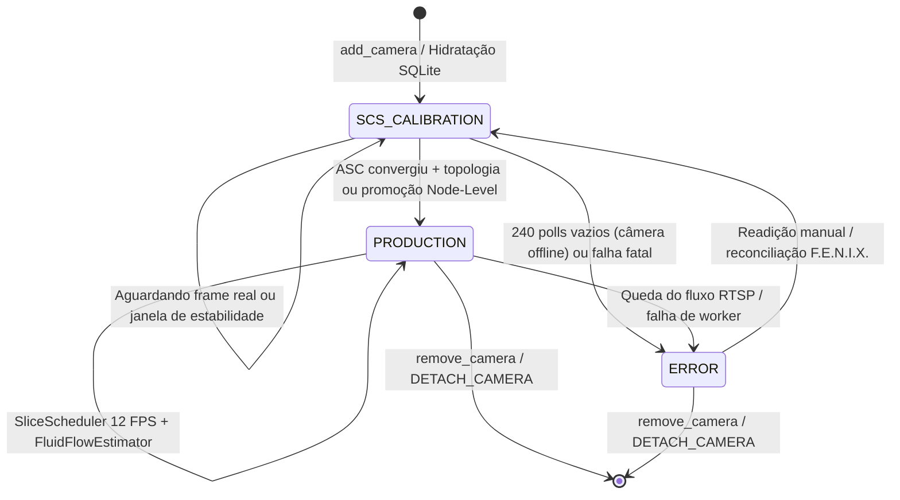

<!-- SPDX-License-Identifier: Proprietary -->
<!-- Copyright (c) 2026-present Gabriel Moraes / SVISION. All rights reserved. -->

# Ciclo de Vida de Câmeras e Calibração Autonômica

Cada sensor cadastrado no SVISION Core percorre uma máquina de estados determinística coordenada por `CameraAgent` (`src/engine/camera_agent.py`), `SCSOrchestrator` (`src/engine/scs_orchestrator.py`), `AutonomicSceneConvergence` (`src/vision/asc_analyzer.py`) e `PipelineSupervisor` (`src/engine/pipeline_supervisor.py`), com persistência em SQLite (`src/common/database.py`) e reconciliação de falhas pelo **F.E.N.I.X.** (`src/fenix/`).

> **Nota de atualização (v1.2.0):** O sistema opera no modelo **Node-Level Traffic Flow** emitindo vetores contínuos via `FluidFlowEstimator`. Módulos obsoletos como `pbt_optimizer.py` e arquivos binários `.pt` de topologia foram removidos; topologias opcionais utilizam arquivos `.json` (`~/Documentos/Svision/topologies/<camera_id>.json`) e calibração métrica via `set_homography`.

---

## 1. Máquina de Estados da Câmera

### Estados Principais

| Estado | Significado | Gatilho de Transição |
| :--- | :--- | :--- |
| **`SCS_CALIBRATION`** | Estado inicial no registro (`add_camera`) ou na hidratação do SQLite no boot | `AutonomicSceneConvergence.start_calibration(camera_id)` |
| **`PRODUCTION`** | Fatiamento ativo a 12 FPS (`SliceScheduler`), inferência YOLO INT8, rastreamento Kalman 2D e emissão contínua de fluxo | Estabilidade atendida + `has_topology()` / promoção Node-Level |
| **`ERROR`** | Câmera inacessível, estouro de `240` leituras vazias (~12s) sem vídeo real ou falha grave de decodificação | Timeout de conexão ou erro irrecuperável no stream |

---

## 2. Fluxo Detalhado de Calibração e Promoção

1. **Registro e Persistência (`add_camera` ou Hidratação):**
   - `CameraStateManager` grava a linha `CameraNode` no SQLite (`svision_telemetry.db`) incluindo `homography_json` e `params_json`.
   - `NvdecStreamDecoder.connect_camera()` inicia a thread de leitura RTSP contínua (`max_dim = 720`).
   - `SynapseUDSClient` envia `ATTACH_CAMERA` ao `bin/synapse-dispatcher` para reservar a porta TCP (`9001+`).
   - `SCSOrchestrator` enfileira `start_calibration(camera_id)`.
2. **Aquisição Estrita de Frames Reais:**
   - `_run_scs_calibration` aguarda vídeo real por até `max_empty_polls = 240` verificações (`~0.05s`). Sem fallback aleatório para câmeras desconectadas.
3. **Avaliação MOG2 + Optical Flow (`ASCAnalyzer`):**
   - Calcula $\text{score} = \min(100.0,\ \text{gmm\_score} \times 0.7 + \text{flow\_stability} \times 100.0 \times 0.3)$.
   - Atingida a janela (`30` frames para `threshold >= 90.0` ou `5` frames com `threshold < 90.0`, padrão `0`), verifica `AutoLaneMapper.has_topology()` / `load_topology()` e promove o nó para **`PRODUCTION`**.

---

## 3. Operação em `PRODUCTION`, Alterações em Tempo Real e Limpeza

- **Estado Isolado:** `PipelineSupervisor` mantém `ModelGearbox` e `KalmanTracker` exclusivos por câmera.
- **Atualizações em Quente (*Live Tuning*):** Os comandos IPC `update_camera_params` e `set_homography` atualizam limiares (`confidence_threshold`, `nms_threshold` no intervalo `[0.05, 0.99]`), abordagem viária e matriz `3x3` imediatamente em memória e no SQLite sem derrubar o stream RTSP.
- **Remoção e Desligamento:** `remove_camera` cancela tarefas SCS, remove do banco SQLite, encerra a thread do `NvdecStreamDecoder` e envia `DETACH_CAMERA` via UDS. No encerramento do sistema (`StdioDaemon.shutdown`), todas as capturas são liberadas, o cache CUDA é esvaziado e o processo Go é encerrado de forma limpa.

---

## 4. Documentação Relacionada

- [Supervisor F.E.N.I.X.](fenix_supervisor.md)
- [Subsistema de Visão](vision_subsystem.md)
- [Pipeline de GPU e Marchas](gpu_pipeline.md)
- [Egress de Dados e Motor de Fluxo](data_egress.md)

---

*Documentação SVISION Core — v1.2.0 (2026-11-16)*
