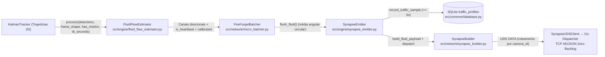

<!-- SPDX-License-Identifier: Proprietary -->
<!-- Copyright (c) 2026-present Gabriel Moraes / SVISION. All rights reserved. -->

# Egress de Dados e Motor de Fluxo Fluido

O SVISION Core publica **telemetria macroscópica direcional de fluxo viário** — sem imagens, sem placas e sem eventos discretos de contagem — operando com entrega **Zero-Backlog Fire-and-Forget** para consumidores Synapse.

> **Nota de atualização (v1.2.0):** Os módulos antigos de contagem por gatilho e buffer em RAM (`trigger_counter.py`, `trigger_detector.py`, `ram_buffer.py` / `ResilientRamBuffer` e `channel_manager.py`) foram removidos. O fluxo atual segue diretamente: `FluidFlowEstimator` → `FireForgetBatcher` → `SynapseEmitter` → `SynapseBuilder` → `SynapseUDSClient` → `CameraStream.Push()` (Go).

---

## 1. Pipeline de Egress Fim-a-Fim



---

## 2. Estimação Macroscópica (`FluidFlowEstimator`)

Em `src/engine/fluid_flow_estimator.py`, `FluidFlowEstimator.process(...)` converte trajetórias 2D em vetores de fluxo:

1. **Delta Temporal Real (`dt_seconds`):** Calcula `eff_fps = 1.0 / eff_dt` com base no intervalo real entre slices para manter estabilidade de velocidade sob jitter.
2. **Densidade Espacial da Via ($\rho$):**
   $$\rho = \text{clip}\!\left(\frac{\sum \text{bbox\_area}}{\text{effective\_road\_area}},\ 0.0,\ 1.0\right)$$
   com área útil padrão `effective_road_area = 0.70 * total_frame_area`.
3. **Velocidade Métrica vs. Fallback Heurístico:**
   - **Calibrado (`"calibrated": true`):** Projeta vetores pela matriz de homografia `3x3` (`cv2.perspectiveTransform`), convertendo deslocamento em km/h reais.
   - **Não Calibrado (`"calibrated": false`):** Aplica estimativa heurística em pixels e sinaliza `"calibrated": false` no payload.
4. **Agrupamento Direcional (`max_angle_diff = 75.0°`):** Agrupa vetores próximos em ângulo em canais distintos (`direction_deg`, `speed`, `density`), suportando múltiplos sentidos na mesma câmera.
5. **Continuidade por Heartbeat:** Sem movimento ativo (`has_motion = False`), marca `"is_heartbeat": true`.

---

## 3. Micro-Batching Circular (`FireForgetBatcher`)

Em `src/network/micro_batcher.py`, o batcher consolida amostras entre ticks de throttle (`SVISION_SYNAPSE_THROTTLE = 0.2s`, máx. 5 Hz):
- Calcula média de `speed` e `density`.
- Calcula **média angular circular** para `direction_deg` via $\operatorname{atan2}(\sum \sin \theta, \sum \cos \theta)$, evitando erros de descontinuidade em `0°`/`360°`.
- Em ociosidade, `flush_fluid()` retorna `[{"direction_deg": 0.0, "speed": 0.0, "density": 0.0}]`.

---

## 4. Payload Canônico, Roteamento Dual-ID e Persistência

### Formato JSON (`SynapseBuilder.build_fluid_payload`)
```json
{
  "camera_id": "CAM_NORTE_01",
  "timestamp": 1794841200123,
  "is_heartbeat": false,
  "calibrated": true,
  "channels": [
    {
      "direction_deg": 92.4,
      "speed": 48.6,
      "density": 0.24
    }
  ]
}
```

### Roteamento `dispatch` & Histórico SQLite
- **Separação de Identificadores (`SynapseBuilder.dispatch(payload, camera_id=None)`):** O campo externo `payload["camera_id"]` leva o `sensor_id` para o receptor Synapse, enquanto `SynapseEmitter` passa explicitamente `camera_id=self._cam_id` (`camera_id or payload.get("sensor_id") or payload.get("camera_id", "")`) para garantir localização exata do socket no `svision-go`.
- **Histórico em SQLite:** `SynapseEmitter.emit()` registra médias agregadas na tabela `traffic_profiles` via `state_manager.record_traffic_sample(...)` (intervalo mínimo `5.0s`) e atualiza o snapshot exibido no `SynapseTelemetryGrid.jsx`.

---

## 5. Documentação Relacionada

- [Synapse Dispatcher (Go)](synapse_dispatcher_go.md)
- [Arquitetura IPC](ipc_architecture.md)
- [Subsistema de Visão](vision_subsystem.md)
- [Referência de API e IPC](api_and_ipc_reference.md)

---

*Documentação SVISION Core — v1.2.0 (2026-11-16)*
