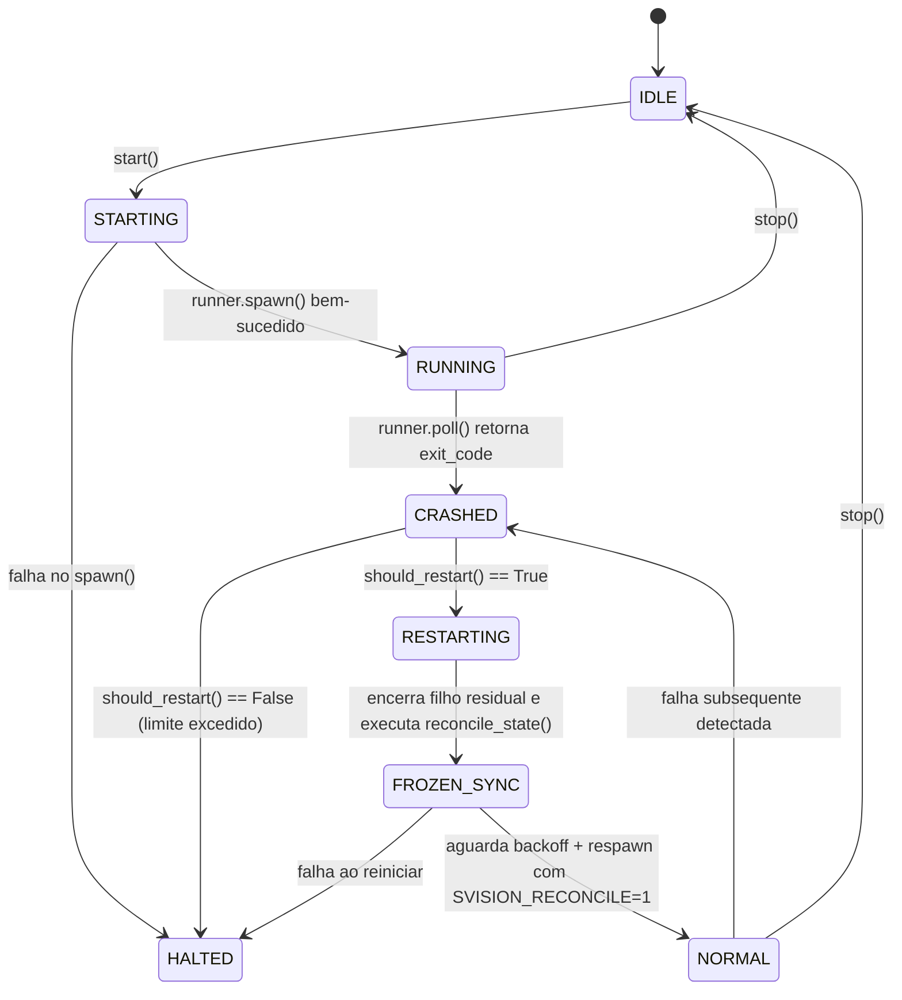

<div align="center">


# Supervisor F.E.N.I.X. — Auto-Recuperação & Reconciliação de Estado
### Guardião Out-of-Process para Isolamento de Falhas CUDA, Anti-Loop e Expurgo de VRAM
*Noxfort Systems — A State Of Art Company*

</div>

⬅️ Voltar para a [Central Master MOC](svision_moc.md) | 🏛️ Ver [Arquitetura](architecture_overview.md) | ⚡ Ver [Pipeline GPU](gpu_pipeline.md) | 🚀 Ver [Implantação](deployment_operations.md)

---

## 1. Visão Geral

O **F.E.N.I.X.** (*Fail-safe Evolutionary Neural Inference eXchange*, implementado em [`src/fenix/`](../../src/fenix)) é o supervisor guardião *out-of-process* do **SVISION**, projetado para isolar falhas fatais de driver CUDA/TensorRT ou bibliotecas nativas, impedir loops infinitos de reinicialização, expurgar memória de vídeo contaminada e ressuscitar o daemon cognitivo headless de forma limpa.

A execução com `svision.py --supervisor` (ou `--fenix`) inicia o `FenixSupervisor`, que monitora continuamente o processo filho `svision.py --daemon` por meio de uma thread watchdog dedicada.

---

## 2. Arquitetura SOLID de Componentes (`src/fenix/`)

Todos os componentes dependem exclusivamente de protocolos `@runtime_checkable` definidos em `src/fenix/protocols.py`:

| Arquivo | Protocolo / Classe | Responsabilidade (SRP) |
|---|---|---|
| `src/fenix/protocols.py` | `FenixState`, `IRecoveryPolicy`, `IProcessRunner`, `IStateReconciler`, `IProcessSupervisor` | Contratos segregados e enum de estados (`IDLE`, `STARTING`, `RUNNING`, `CRASHED`, `RESTARTING`, `FROZEN_SYNC`, `NORMAL`, `HALTED`). |
| `src/fenix/fenix_supervisor.py` | `FenixSupervisor` | Fachada de alto nível que coordena o spawn do processo filho, loop watchdog (`poll_interval_seconds=1.0`), tratamento de crash, reconciliação e desligamento. |
| `src/fenix/process_runner.py` | `SubprocessRunner` | Gerencia `subprocess.Popen` com `spawn()`, `poll()` e encerramento seguro (`SIGTERM` com fallback para `SIGKILL`). |
| `src/fenix/multiprocessing_runner.py` | `MultiprocessingProcessRunner` | Adapta `multiprocessing.Process` ao contrato `IProcessRunner` para supervisão de workers em multiprocessamento. |
| `src/fenix/recovery_policy.py` | `WindowedCrashRecoveryPolicy` | Disjuntor anti-loop em janela deslizante e cálculo de backoff exponencial progressivo. |
| `src/fenix/state_reconciler.py` | `VisionStateReconciler` | Executa expurgo de VRAM (`torch.cuda.empty_cache()`, `torch.cuda.ipc_collect()`), sincroniza o registro de câmeras do `StateManager` e verifica o socket UDS (`config.SYNAPSE_UDS_PATH`). |

---

## 3. Máquina de Estados & Fluxo de Ressurreição



### Sequência de Ressurreição (`resurrect_engine()`)
1. **Avaliação Anti-Loop**: `WindowedCrashRecoveryPolicy.should_restart()` verifica se a quantidade de quedas dentro da janela deslizante (`crash_window_seconds=60.0`) não excedeu `max_consecutive_crashes=5`. Se exceder, o estado muda para `FenixState.HALTED` para proteger CPU/GPU.
2. **Encerramento de Zumbis**: Executa `runner.terminate(timeout_seconds=2.0)` (`SIGTERM`, escalando para `SIGKILL` após timeout).
3. **Expurgo de VRAM & Reconciliação (`FROZEN_SYNC`)**:
   - Aciona `gc.collect()`, `torch.cuda.empty_cache()` e `torch.cuda.ipc_collect()`.
   - Reconcilia os IDs de câmeras ativos a partir de `StateManager.get_cameras()`.
   - Verifica a presença do socket Unix do despachante Go em `config.SYNAPSE_UDS_PATH` (`/tmp/svision_synapse.sock`).
4. **Backoff Exponencial Progressivo**: Aplica espera de `restart_backoff_seconds * min(2 ** (crash_count - 1), 8)` segundos (padrões: `1.0s`, `2.0s`, `4.0s`, `8.0s`).
5. **Respawn Limpo**: Reinicia o daemon com `SVISION_SUPERVISED=1`, `SVISION_RECONCILE=1` e `PYTHONUNBUFFERED=1`, transitando para `FenixState.NORMAL`.

---

## 4. Uso via CLI & Variáveis de Ambiente

### Execução sob Supervisão F.E.N.I.X.
```bash
# Inicia o daemon headless do SVISION protegido pelo guardião F.E.N.I.X.
python svision.py --supervisor
# Alias equivalente:
python svision.py --fenix
```

### Variáveis Injetadas no Processo Filho
| Variável | Valor | Finalidade |
|---|---|---|
| `SVISION_SUPERVISED` | `"1"` | Informa ao daemon filho que seu ciclo de vida é gerenciado pelo supervisor F.E.N.I.X. |
| `SVISION_RECONCILE` | `"1"` (na ressurreição) | Sinaliza que o processo foi reiniciado após passagem pelo `VisionStateReconciler`. |
| `PYTHONUNBUFFERED` | `"1"` | Garante descarregamento imediato de logs e mensagens entre pipes. |

---

## 5. Diagnóstico Estruturado

`VisionStateReconciler.get_status_summary()` fornece um resumo auditável utilizado pelas suítes de teste (`tests/test_fenix_*.py`):

```python
{
    "is_reconciled": True,
    "reconciled_cameras_count": 4,
    "reconciled_cameras": ["cam_01", "cam_02", "cam_03", "cam_04"],
    "vram_purged_count": 1,
    "uds_socket_exists": True,
}
```

---

## Documentos Relacionados

- [🏠 Central Master MOC](svision_moc.md)
- [🏛️ Arquitetura do Sistema](architecture_overview.md)
- [⚡ Pipeline de Inferência GPU](gpu_pipeline.md)
- [🚀 Implantação em Workstation](deployment_operations.md)
- [🧪 Desenvolvimento & Testes](development_testing.md)

---

<div align="center">
  <br/>
  <b>Noxfort Systems</b> — <i>A State Of Art Company</i><br/>
  <i>Engenharia de Visão Soberana para Workstations • SVISION v1.2.0</i><br/>
  <small>© 2026 Noxfort Systems • SPDX-License-Identifier: AGPL-3.0-or-later</small>
</div>
