<!-- SPDX-License-Identifier: Proprietary -->
<!-- Copyright (c) 2026-present Gabriel Moraes / SVISION. All rights reserved. -->

# Pipeline de GPU, Fatiamento Temporal e Marchas Dinâmicas

O pipeline de inferência em GPU do SVISION Core (`src/engine/`) foi projetado para extrair máxima densidade de câmeras por GPU NVIDIA mantendo latência determinística a **12 FPS**, isolamento estrito por fluxo e proteção térmica/VRAM em tempo real.

---

## 1. Visão Integrada da Execução em GPU

```mermaid
flowchart LR
    DEC["NvdecStreamDecoder<br/>Frames contínuos (<=720px)"] -->|"~83.3 ms (12 FPS)"| SCHED["SliceScheduler<br/>src/engine/slice_scheduler.py"]
    SCHED -->|"Amostragem periférica 320px"| MOT["MotionExtractor<br/>Crops foveados >=64px + pad 32px"]
    MOT -->|"Staging volátil RAM"| POOL["RamStagingPool"]
    POOL -->|"Priorização demanda x latência"| VIP["VipKernelScheduler<br/>Lotes dinâmicos (4..32)"]
    GOV["ElasticGovernor<br/>VRAM (15% / 1000MB) & Temp"] -->|"Telemetria + Throttling"| VIP
    VIP -->|"Chunking <= MAX_BATCH"| TRT["TritonInt8Engine<br/>YOLO11 INT8 TensorRT"]
    TRT -->|"Detecções isoladas por câmera"| SUP["PipelineSupervisor<br/>ModelGearbox + KalmanTracker 2D"]
    SUP --> FFE["FluidFlowEstimator<br/>Canais direcionais -> Synapse"]
```

---

## 2. Orquestrador Temporal a 12 FPS (`SliceScheduler`)

Substituindo pipelines de loop contínuo sem controle de fase, o `SliceScheduler` (`src/engine/slice_scheduler.py`) opera no ritmo canônico de **12 FPS** (`SVISION_PIPELINE_TARGET_FPS = 12.0`, intervalo de `0.0833s`) gerenciado pelo `PipelineOrchestrator`:

- **Jitter de Fase Anti-Rajada (`-10ms` a `+10ms`):** Câmeras têm suas janelas escalonadas dentro do ciclo de `83.3 ms` via `SVISION_JITTER_MIN` / `SVISION_JITTER_MAX`, evitando picos simultâneos de decodificação CPU/NVDEC e alocação CUDA.
- **Extração Foveada (`MotionExtractor`):** Cada slice é avaliado primeiro em resolução periférica (`SVISION_PERIPHERAL_WIDTH = 320 px`). Somente regiões com movimento persistente (`SVISION_TEMPORAL_MIN_FRAMES = 3` em grade de `32px`) geram crops de alta resolução (dimensão mínima `64px`, padding `32px`) armazenados no `RamStagingPool`.
- **Fallback `CUDABatchConsumer`:** O módulo `cuda_batch_consumer.py` atua como consumidor auxiliar/fallback compatível quando o fluxo requer processamento de lote desacoplado.

---

## 3. Motor TensorRT INT8 com Chunking Automático (`TritonInt8Engine`)

Localizado em `src/engine/triton_int8_engine.py`, gerencia quatro engines YOLO11 compiladas em precisão INT8 (`Nano`, `Small`, `Medium`, `Heavy`) dentro de `src/models/yolo/`:

- **Inspeção Dinâmica de `MAX_BATCH` (`_read_engine_batch_limit()`):** Ao carregar um `.engine`, o motor inspeciona os limites reais de binding TensorRT do arquivo compilado (usando `SVISION_TRT_MAX_BATCH = 16` como fallback).
- **Fatiamento Seguro de Lotes (*Chunking*):** Caso o `VipKernelScheduler` entregue 24 crops de múltiplas câmeras simultâneas para uma engine com limite 16, `TritonInt8Engine` subdivide automaticamente em chunks compatíveis (`16 + 8`), evitando falhas silenciosas ou estouros de contexto CUDA.
- **Carregamento Sob Demanda & Eviction:** Com `SVISION_GEARBOX_ON_DEMAND = True`, marchas mais pesadas só ocupam VRAM quando efetivamente exigidas, podendo ser descarregadas sob pressão crítica de memória.

---

## 4. Câmbio Dinâmico de Marchas (`ModelGearbox`) & Isolamento (`PipelineSupervisor`)

| Marcha (`Gear`) | Modelo Base | Cenário Típico de Uso |
| :--- | :--- | :--- |
| **`Nano`** | `yolo11n.engine` | Baixa complexidade, alta densidade de câmeras ou modo econômico sob pressão térmica/VRAM. |
| **`Small`** | `yolo11s.engine` | Equilíbrio padrão para vias urbanas moderadas. |
| **`Medium`** | `yolo11m.engine` | Cruzamentos densos e veículos de pequeno porte a média distância. |
| **`Heavy`** | `yolo11l.engine` | Alta oclusão ou cenas complexas com folga ampla de VRAM e GPU. |

- **Isolamento por Câmera:** O `PipelineSupervisor` (`src/engine/pipeline_supervisor.py`) instancia um `ModelGearbox` e um `KalmanTracker` próprios para cada `camera_id`, eliminando interferência cruzada e troca prematura de marchas entre câmeras diferentes.
- **Anti-Oscilação (*Heavy Dwell*):** `SVISION_HEAVY_DWELL_SECONDS = 30.0` garante permanência mínima na marcha `Heavy` antes de permitir redução, evitando *thrashing* de troca de engine em GPU.

---

## 5. Governança Elástica e Escalonamento VIP

### `ElasticGovernor` (`src/engine/elastic_governor.py`)
- Monitora utilização de GPU, temperatura e VRAM livre em tempo real (suavização EMA com `alpha = 0.15`).
- Mantém reserva mínima de **`15%` (`SVISION_VRAM_SAFETY_RATIO = 0.15`)** e piso crítico absoluto de **`1000.0 MB` (`SVISION_VRAM_CRITICAL_MB`)**.
- Quando VRAM ou temperatura atingem patamares críticos, dispara `gpu_health_alert` para o frontend e força redução de marchas e tamanho de lote no `VipKernelScheduler`.

### `VipKernelScheduler` (`src/engine/vip_scheduler.py`)
- Calcula prioridade de cada requisição de inferência ponderando demanda de movimento (`SVISION_DEMAND_WEIGHT = 1.2`) e tempo de espera (`SVISION_LATENCY_WEIGHT = 0.8`).
- Ajusta dinamicamente o tamanho alvo do lote entre `SVISION_SCHEDULER_MIN_BATCH = 4` e `SVISION_SCHEDULER_MAX_BATCH = 32` (padrão `20`) com base no orçamento estimado por crop (`SVISION_CROP_COST_MB = 12.0`).

---

## 6. Documentação Relacionada

- [Supervisor F.E.N.I.X.](fenix_supervisor.md)
- [Subsistema de Visão](vision_subsystem.md)
- [Referência de Configuração](configuration_reference.md)
- [Desenvolvimento e Compilação INT8](development_testing.md)

---

*Documentação SVISION Core — v1.2.0 (2026-11-16)*
