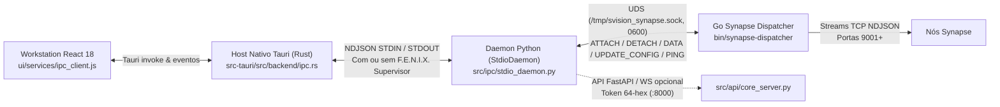

<!-- SPDX-License-Identifier: Proprietary -->
<!-- Copyright (c) 2026-present Gabriel Moraes / SVISION. All rights reserved. -->

# Arquitetura IPC e Comunicação Entre Processos

O SVISION Core conecta seus três planos de execução por meio de mensagens **NDJSON via STDIN/STDOUT** (entre Tauri/Rust e Python/F.E.N.I.X.) e **Unix Domain Socket (UDS)** (entre Python e o sidecar Go `bin/synapse-dispatcher`), além de um servidor HTTP/WebSocket opcional em `src/api/` (`:8000`).

---

## 1. Topologia de Comunicação

---

## 2. Ponte STDIN / STDOUT NDJSON (Rust ↔ Python)

- **Lado Rust (`src-tauri/src/backend/`):** `ipc.rs`, `mod.rs` e `state.rs` gerenciam o processo filho Python e expõem `send_svision_command` e `get_backend_status` à interface React.
- **Lado Python (`src/ipc/stdio_daemon.py` & `stdio_transport.py`):**
  - **Hidratação no Boot:** `StdioDaemon.main()` acopla o `SQLiteStateRepository` (`state_manager.attach_persistence(..., load_existing=True)`) e executa `_hydrate_persisted_cameras()` para reconectar câmeras salvas ao `NvdecStreamDecoder`, `SynapseUDSClient` e `SCSOrchestrator`.
  - **Transporte Sincronizado:** `StdoutTransport` serializa mensagens JSON por linha com bloqueio de thread para evitar intercalação de bytes.
  - **Encerramento Limpo (`shutdown()`):** Interrompe o `PipelineOrchestrator`, fecha o `SynapseUDSClient`, chama `stream_decoder.disconnect_all()`, esvazia a memória CUDA e finaliza o binário `synapse-dispatcher`.

---

## 3. Roteamento de Comandos (`src/ipc/command_handlers.py`)

| Comando (`cmd`) | Função |
| :--- | :--- |
| `ping` | Verifica responsividade do daemon (`pong`). |
| `sync_state` | Retorna estado completo (`cameras`, `engine_stats`, `network_stats`, `synapse_ports`, `synapse_host`, `homography_matrices`, `camera_params`). |
| `add_camera` | Registra sensor no SQLite, reserva porta TCP via UDS, inicia captura e enfileira calibração SCS. |
| `remove_camera` | Cancela calibração, apaga registro do SQLite, para decodificação e envia `DETACH_CAMERA`. |
| `set_cameras` | Sincronização em lote da lista de câmeras. |
| `update_synapse_config` | Atualiza `synapse_host`, grava em `settings.ini` e propaga `UPDATE_CONFIG` ao Go. |
| `set_homography` | Grava matriz `3x3` ou calcula via `>= 4` pares `image_points`/`world_points` no `AutoLaneMapper`. |
| `update_camera_params` | Atualiza `confidence_threshold` / `nms_threshold` (clamped em `[0.05, 0.99]`), `nominal_direction` e `approach` no SQLite e em memória. |

---

## 4. Eventos Assíncronos de Telemetria (`src/ipc/telemetry_broadcaster.py`)

O `TelemetryBroadcaster` publica eventos periódicos em STDOUT no intervalo `SVISION_TELEMETRY_INTERVAL` (padrão `1.0s`):
- **`ready`**: Boot e hidratação concluídos.
- **`cameras`**: Lista de câmeras com status, FPS, marcha, porta Synapse, matriz de homografia e `tuning_params`.
- **`engine_stats`**: Carga GPU/CPU, uso de VRAM/RAM, temperatura, marcha ativa e métricas do `SliceScheduler`.
- **`network_stats`**: Último payload fluido por câmera (`channels`, `calibrated`, `is_heartbeat`, contadores de rede).
- **`synapse_ports`**: Estado atual das portas TCP no Go (`READY`, `CONNECTING`, `CONNECTED`, `DISCONNECTED`, `CLOSED`).
- **`network_latency`**: Latência por sensor.
- **`gpu_health_alert`**: Alertas críticos emitidos pelo `ElasticGovernor`.

---

## 5. Integração F.E.N.I.X. e Modo Demonstração UI

- Quando iniciado via `svision.py --supervisor`, o `FenixSupervisor` encapsula o worker `--daemon --supervised`, mantendo a interface IPC estável diante de reinícios após falha.
- Quando a UI roda sem Tauri (`npm run dev` ou `?demo=true`), `ui/services/ipc_client.js` emula todo o contrato IPC localmente, incluindo calibração de homografia e ajuste de parâmetros em tempo real.

---

## 6. Documentação Relacionada

- [Supervisor F.E.N.I.X.](fenix_supervisor.md)
- [Synapse Dispatcher (Go)](synapse_dispatcher_go.md)
- [Referência de API e IPC](api_and_ipc_reference.md)
- [UI Desktop e Tauri](desktop_ui_tauri.md)

---

*Documentação SVISION Core — v1.2.0 (2026-11-16)*
