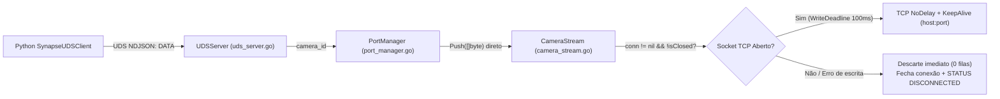

<!-- SPDX-License-Identifier: Proprietary -->
<!-- Copyright (c) 2026-present Gabriel Moraes / SVISION. All rights reserved. -->

# Synapse Dispatcher (Go)

O módulo `svision-go/` (`package main`, compilado como `bin/synapse-dispatcher`) é o sidecar de rede em Go do SVISION Core. Ele isola a gestão de sockets TCP e alocação de portas do runtime Python, garantindo entrega de telemetria **Zero-Backlog Fire-and-Forget** sem bloqueios no GIL nem retenção de pacotes atrasados.

---

## 1. Estrutura de Pacote Plano (`svision-go/`)

| Arquivo | Responsabilidade |
| :--- | :--- |
| [`main.go`](../../svision-go/main.go) | Parseia flags (`--uds`, `--host`, `--base-port`), inicializa `PortManager` e `UDSServer` e trata `SIGINT`/`SIGTERM`. |
| [`uds_server.go`](../../svision-go/uds_server.go) | Socket Unix `/tmp/svision_synapse.sock` com permissão estrita `0600` (`SVISION_SYNAPSE_UDS_MODE`), leitura NDJSON limitada a `1 MB` e despacho de comandos. |
| [`port_manager.go`](../../svision-go/port_manager.go) | Orquestra vínculos de câmeras (`AttachCamera`, `DetachCamera`, `PushData`, `UpdateHost`) e eventos de status. |
| [`port_allocator.go`](../../svision-go/port_allocator.go) | Pool thread-safe de portas TCP a partir de `--base-port` (padrão `9001`), respeitando `preferred_port` quando livre. |
| [`camera_stream.go`](../../svision-go/camera_stream.go) | Interface `StreamDialer`/`DefaultTCPDialer`, worker de reconexão e envio direto `Push([]byte)` sem fila. |
| `*_test.go` | Cinco arquivos de testes unitários e de integração em Go. |

---

## 2. Arquitetura Zero-Backlog (Sem Filas em Memória)



- **Ausência Deliberada de `chan []byte`:** Não há fila com buffer no `CameraStream`. A função `Push(payload)` adquire o mutex da conexão e grava diretamente no socket TCP (anexando `\n` quando necessário) com timeout de **`100ms`**.
- **Descarte Instantâneo:** Se o destino estiver indisponível (`isClosed` ou `conn == nil`), o pacote é descartado na hora (`return false`), impedindo explosões de eventos obsoletos quando o receptor volta ao ar.
- **Reconexão em Background (`runWorker`):** A cada **`2 segundos`**, caso `conn == nil`, o worker tenta restabelecer conexão TCP (`1500ms` de dial timeout) configurando `SetNoDelay(true)` e `KeepAlivePeriod = 10s`.

---

## 3. Protocolo UDS (Python ↔ Go)

### Comandos Recebidos (Python → Go)
| Comando | Campos | Comportamento e Resposta |
| :--- | :--- | :--- |
| **`ATTACH_CAMERA`** | `camera_id`, `sensor_id`, `preferred_port` | Reserva porta TCP e responde com **`CAMERA_BOUND`** (`status: "READY"`, `port`). |
| **`DETACH_CAMERA`** | `camera_id` | Fecha o stream e libera a porta; responde com **`CAMERA_DETACHED`** (`status: "CLOSED"`). |
| **`DATA`** | `camera_id`, `payload` | Localiza o `CameraStream` pelo `camera_id` e invoca `Push(payload)` sem bloqueio. |
| **`UPDATE_CONFIG`** | `synapse_host` | Atualiza o host alvo nos streams ativos, força redial e emite **`CONFIG_UPDATED`**. |
| **`PING`** | — | Responde imediatamente com **`PONG`**. |

### Eventos Emitidos (Go → Python)
`CAMERA_BOUND`, `CAMERA_DETACHED`, `STATUS_CHANGE` (`CONNECTING`, `CONNECTED`, `DISCONNECTED`, `CLOSED`), `CONFIG_UPDATED`, `PONG` e `ERROR`.

---

## 4. Compilação e Testes

```bash
cd svision-go
go build -o ../bin/synapse-dispatcher .
go test -v -cover ./...
go test -race ./...
```

---

## 5. Documentação Relacionada

- [Arquitetura IPC](ipc_architecture.md)
- [Egress de Dados e Motor de Fluxo](data_egress.md)
- [Referência de API e IPC](api_and_ipc_reference.md)
- [Segurança e LGPD](security_lgpd.md)

---

*Documentação SVISION Core — v1.2.0 (2026-11-16)*
