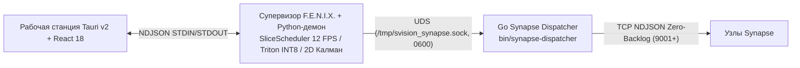

<!-- SPDX-License-Identifier: Proprietary -->
<!-- Copyright (c) 2026-present Gabriel Moraes / SVISION. All rights reserved. -->

# Обзор архитектуры — SVISION Core v1.2.0

SVISION Core построен на трёхуровневой архитектуре с отказоустойчивым супервизором **F.E.N.I.X.**, каноническим планировщиком **12 FPS (`SliceScheduler`)** и передачей телеметрии без очередей (**Zero-Backlog Fire-and-Forget**) узлам Synapse.

## Ключевые принципы

1. **Надёжность под управлением F.E.N.I.X. (`src/fenix/`):** В режиме `--supervisor` / `--fenix` компонент `FenixSupervisor` отслеживает состояние рабочего процесса, очищает VRAM через `VisionStateReconciler` и автоматически перезапускает демон при сбоях.
2. **GPU-конвейер 12 FPS (`src/engine/`):** `SliceScheduler` управляет фовеальным выделением областей движения (`MotionExtractor`), очередями `VipKernelScheduler`, тепловым/VRAM-контролем (`ElasticGovernor`) и инференсом TensorRT INT8 (`TritonInt8Engine`) с изолированными по камерам `ModelGearbox` и `KalmanTracker`.
3. **Сетевой вывод без буферных очередей:** `FluidFlowEstimator` и `FireForgetBatcher` формируют направленные потоки (`direction_deg`, `speed`, `density`, `calibrated`, `is_heartbeat`) и передают их через `svision-go` (пакет немедленно отбрасывается, если TCP-соединение недоступно).
4. **Хранение в SQLite и защита данных:** База `svision_telemetry.db` сохраняет только настройки камер, матрицы гомографии `3x3` и агрегированные профили трафика — без сохранения кадров или номеров автомобилей.

Подробные спецификации на английском языке: [Architecture Overview (EN)](../en/architecture_overview.md) и [F.E.N.I.X. Supervisor (EN)](../en/fenix_supervisor.md).

---

*Документация SVISION Core — v1.2.0 (2026-11-16)*
