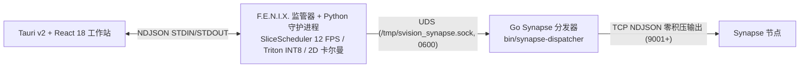

<!-- SPDX-License-Identifier: Proprietary -->
<!-- Copyright (c) 2026-present Gabriel Moraes / SVISION. All rights reserved. -->

# 架构概览 — SVISION Core v1.2.0

SVISION Core 采用三层解耦架构，结合 **F.E.N.I.X. 容错监管器**、**12 FPS 标准时间片调度（`SliceScheduler`）** 以及面向 Synapse 节点的 **Zero-Backlog（零积压即发即弃）** 实时分发机制。

## 核心设计原则

1. **F.E.N.I.X. 自动容错（`src/fenix/`）：** 使用 `--supervisor` 或 `--fenix` 启动时，`FenixSupervisor` 持续监控工作进程，在异常退出时通过 `VisionStateReconciler` 清理显存并带退避重试恢复服务。
2. **12 FPS GPU 推理流水线（`src/engine/`）：** `SliceScheduler` 以约 `83.3 ms` 节拍驱动周边运动提取（`MotionExtractor`）、动态批调度（`VipKernelScheduler`）、显存/温控保护（`ElasticGovernor`）与 TensorRT INT8 推理（`TritonInt8Engine`），并为每路相机隔离独立的 `ModelGearbox` 和线性 2D `KalmanTracker`。
3. **零积压宏观交通流输出：** `FluidFlowEstimator` 与 `FireForgetBatcher` 聚合多方向交通流矢量（`direction_deg`、`speed`、`density`、`calibrated`、`is_heartbeat`），经由 `svision-go` 直接写入 TCP 套接字；若下游离线则立即丢弃数据包，防止过期数据堆积。
4. **SQLite 持久化与隐私保护：** `svision_telemetry.db` 仅保存相机配置、`3x3` 单应性矩阵与匿名宏观交通统计，不持久化任何视频帧或车牌数据。

完整英文技术规范请参阅 [Architecture Overview (EN)](../en/architecture_overview.md) 与 [F.E.N.I.X. Supervisor (EN)](../en/fenix_supervisor.md)。

---

*SVISION Core 文档 — v1.2.0 (2026-11-16)*
